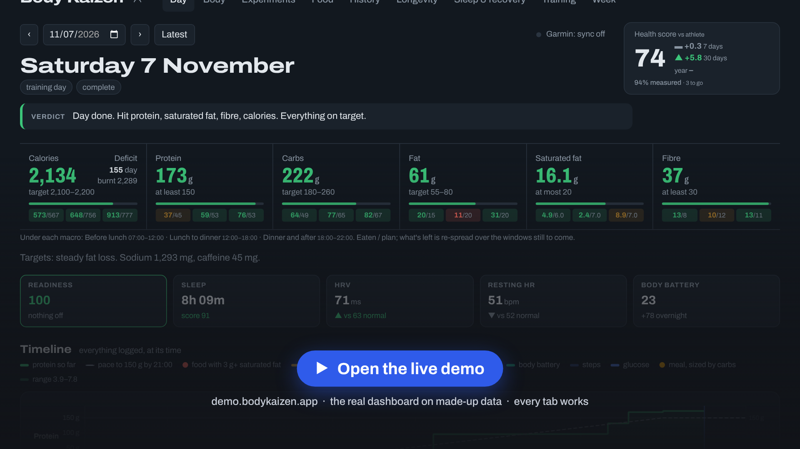
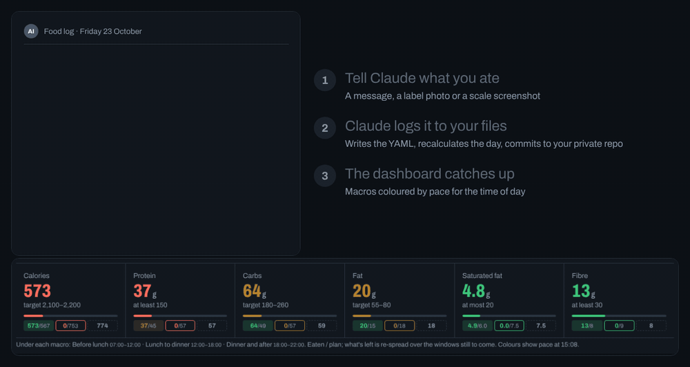
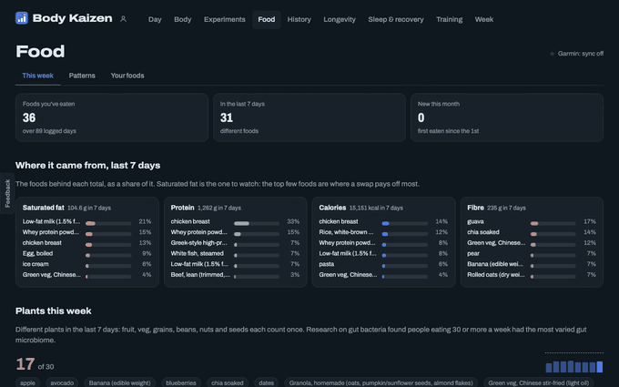
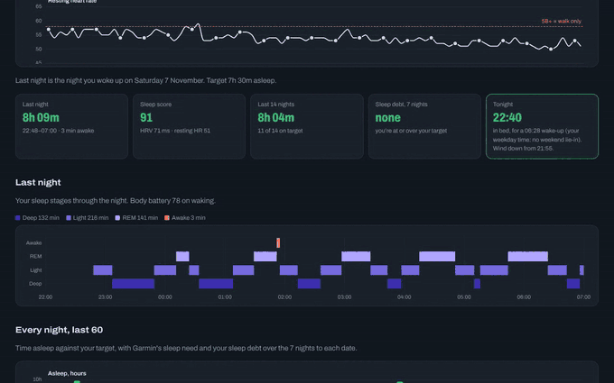
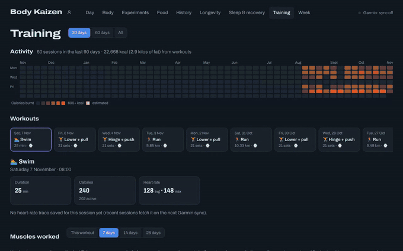
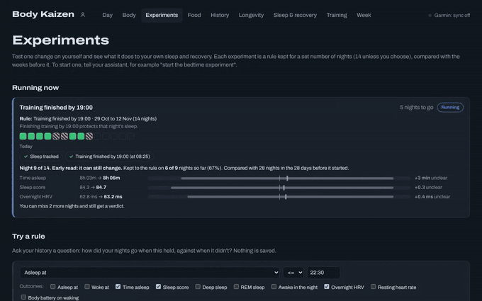
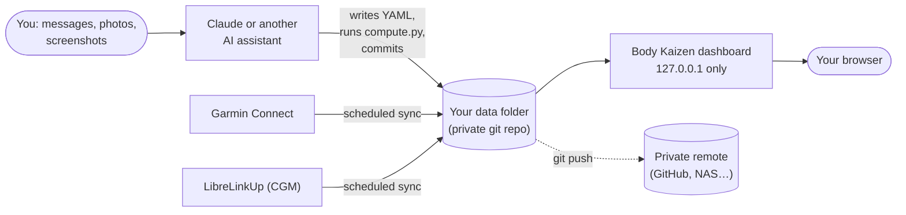

#  Body Kaizen

[](https://github.com/craigbennett1981/body-kaizen/actions/workflows/ci.yml)
[](https://www.python.org/)
[](LICENSE)
[](SECURITY.md)
[](SECURITY.md)
[](#project-layout)

**A private dashboard for continuous improvement of your health.** Food, sleep, training, recovery and healthspan,
tracked as your own n-of-one experiment, in plain files you own.

<p align="center">
  <a href="https://demo.bodykaizen.app/"><b>▶&nbsp; Try the live demo</b></a> &nbsp;·&nbsp;
  <a href="#quick-start"><b>Quick start</b></a> &nbsp;·&nbsp;
  <a href="docs/features.md"><b>Every page, explained</b></a>
</p>

<table>
<tr>
<td width="50%" align="center" valign="top"><video src="https://github.com/user-attachments/assets/546fda47-0f14-4d7f-ad06-d2654cdf2f6c" controls playsinline width="100%"></video>
<b>▶ A day with Body Kaizen</b>, a 3-minute tour</td>
<td width="50%" align="center" valign="middle"><a href="https://demo.bodykaizen.app/"></a><br>
<b>Try the live demo</b> on 90 days of made-up data</td>
</tr>
</table>

You tell an AI assistant like Claude what you ate, send it a photo of a label or a screenshot of your scale, and
it writes everything into your own private git repository. Body Kaizen works out the macros, pulls in your
Garmin, glucose and gym data, and shows how your day, week and months are going against the targets you set. The
[live demo](https://demo.bodykaizen.app/) is the real dashboard on 90 days of made-up data:
click anything.



> **Please read first:** Body Kaizen is a free wellness tool, not medical advice or a medical device, and it comes
> with no warranty: you use it, and act on what it or your AI assistant shows you, at your own risk. It isn't for
> under 18s, pregnancy, eating disorders or adjusting medication; see the full [Disclaimer](DISCLAIMER.md).

## Highlights

<table>
<tr>
<td width="50%" valign="top"><br>
<b>Know your food.</b> Where this week's saturated fat, protein and fibre came from, plants against 30, swaps from
foods you already eat, and every food you've logged, searchable and sortable.</td>
<td width="50%" valign="top"><br>
<b>Sleep better.</b> Last night's stages, every night against Garmin's sleep need for it, your sleep debt, when to
be in bed tonight, and which of your own days go with the bad nights, with advice from what it finds.</td>
</tr>
<tr>
<td width="50%" valign="top"><br>
<b>Train with feedback.</b> Intensity minutes and your heart-rate zones against the 80/20 line, every session with
coach notes and heart rate, lifts against last time, and a muscle map of your hard sets.</td>
<td width="50%" valign="top"><br>
<b>Test what works for you.</b> Try one change, like a 22:30 bedtime or less salt, for a few weeks and see what it
really does to your sleep, blood pressure or weight, judged against the weeks before.</td>
</tr>
</table>

### Every tab

| Tab | What it shows |
|---|---|
| **Day** | Every macro paced through the day, readiness, energy balance, and a timeline from sleep to dinner with glucose under each meal |
| **Body** | Weight trend, body composition, energy balance against the scale, your real maintenance from what you ate and what the scale did, InBody scans, blood pressure |
| **Experiments** | Test one change on yourself, like a 22:30 bedtime every night or less salt every day: suggested from your own data, with a daily checklist and reminders, tracked day by day and scored against the weeks before. "Try a rule" and "Look for a relationship" ask your history first |
| **Food** | Where your saturated fat, protein and fibre come from, plants this week against 30, swaps from foods you already eat, glucose by food and by meal, every food you've logged |
| **History** | Weight with what explains it (blood tests, scans, target and training changes, off episodes), mood scores and symptoms, and every event |
| **Longevity** | VO2 max, lipids, HbA1c, grip and more against target bands, with a health score and retest dates |
| **Sleep & recovery** | Last night's stages, when to be in bed tonight, readiness, every night against Garmin's sleep need, sleep debt, HRV and resting heart rate, and what goes with your better and worse nights |
| **Training** | An activity calendar, intensity minutes and heart-rate zones against the 80/20 line, every session with coach notes and heart rate, lifts against last time, a muscle map, a progression plan and lift charts |
| **Week** | The week at a glance, what to change next week, every day hit or miss against its targets, habits, new bests, and all the advice from your own data |

Every tab but Day is split into sub-tabs, so one part is on screen at a time (Training has Overview, Workouts and
Progress, for example), and links like `#training/progress` open one directly. Every page in detail, with
screenshots: **[docs/features.md](docs/features.md)**. Or open it in the **[live demo](https://demo.bodykaizen.app/)**.

**Works with** Claude (or any AI assistant that can edit files) · Garmin Connect · FreeStyle Libre (LibreLinkUp) ·
Hevy · InBody · any smart scale or blood-pressure app you can screenshot.

> **Not medical advice, and no warranty.** Body Kaizen is a personal logging tool. Its scores, targets and
> suggestions are rules of thumb, not a diagnosis or treatment plan. AI assistants make mistakes, so check what
> yours logs. Integrations are unofficial, and you're responsible for your own health decisions, accounts and data.
> It's a wellness tool, not a medical device, and it isn't for under 18s, pregnancy, anyone with a history of eating
> disorders, or anyone adjusting insulin or medication from its numbers. Read the [Disclaimer](DISCLAIMER.md) before
> using it.

## Ask it anything about your data

Your whole history is plain text in one folder your assistant can read, so you can ask in your own words and get
answers from your own numbers:

- *"How's my recovery looking today?"*: last night's sleep, HRV and resting heart rate against your baseline, and
  whether to train hard, easy or not at all.
- *"Where's my saturated fat coming from this week?"*: the foods behind it, ranked, with a swap for the worst one.
- *"Why am I sleeping badly?"*: your bedtimes, stages and wake-ups, and which of your days go with the bad nights.
- *"Am I losing fat or muscle?"*: scale and InBody trends side by side, against what your calorie balance predicts.
- *"What should I eat for dinner to hit protein?"*: what's left of today's targets, turned into a meal.

The dashboard shows the numbers; the assistant explains them and turns them into a next step. It reads the same
files the dashboard does, so its answers match what you see.

## Contents

[Quick start](#quick-start) · [How it works](#how-it-works) · [Logging](#logging-you-need-an-ai-assistant) ·
[Integrations](#integrations) · [Privacy in git](#keeping-your-data-private-in-git) · [FAQ](#faq) ·
[Project layout](#project-layout) · [Contributing](#contributing)

**Guides:** [Every page](docs/features.md) · [Logging with Claude](docs/logging-with-claude.md) ·
[Integrations](docs/integrations.md) · [What kit is worth having](docs/kit.md) · [The data folder](docs/data-folder.md) ·
[How your numbers are judged](docs/thresholds.md) · [Data format](SCHEMA.md) · [Disclaimer](DISCLAIMER.md)

## Quick start

**1. Install.** One line, and no Python needed (the installer brings its own):

```bash
# macOS or Linux, in Terminal
curl -fsSL https://raw.githubusercontent.com/craigbennett1981/body-kaizen/main/install/install.sh | sh
```

```powershell
# Windows, in PowerShell
powershell -ExecutionPolicy ByPass -c "irm https://raw.githubusercontent.com/craigbennett1981/body-kaizen/main/install/install.ps1 | iex"
```

It installs Body Kaizen with the Garmin and LibreLinkUp syncs, starts it whenever you log in, adds a **Body Kaizen**
launcher, and opens the dashboard in your browser. Want a look first? Try the [live demo](https://demo.bodykaizen.app/).

**2. Choose your data folder.** The first page asks where to keep your data and how: plain files, plain files with
a git history (every change saved as a version), or that plus a private GitHub backup
([the differences](docs/data-folder.md#how-your-data-is-kept)). Then your name, start date, timezone and units: metric
(kg, km, g, ml) or imperial (lb, mi, oz, fl oz).
Change any of them later from the profile icon. Set your targets and defaults in `targets.yaml` and `settings.yaml`:
see [docs/data-folder.md](docs/data-folder.md).

**3. Connect your AI assistant.** The dashboard then shows a prompt to copy: paste it into Claude Code, opened on
your data folder, and it reads the guide, writes your `CLAUDE.md` and asks about your training, habits and goals.
The same prompt is under the profile icon any time. To log from your phone through a Claude project, or with another
assistant, see [docs/logging-with-claude.md](docs/logging-with-claude.md) and [docs/CLAUDE.example.md](docs/CLAUDE.example.md).

**4. Connect your watch and glucose sensor** (optional) under **Connections** at the foot of the dashboard: your
Garmin login, and a LibreLinkUp follower account for a FreeStyle Libre
([how to set that up](docs/integrations.md#abbott-librelinkup-continuous-glucose)).

**Signing in.** Only your account on this computer can open the dashboard. There's no password: the installer signs
your browser in, and the **Body Kaizen** launcher (Applications on a Mac, the Start menu on Windows, the applications
menu on Linux) signs in any other browser, once. It works by a secret key in `~/.body-kaizen` that only your
account can read; other accounts on the computer see a "not signed in" page and none of your data. More in
[SECURITY.md](SECURITY.md).

**Update or remove.** Run the install line again to update. To remove Body Kaizen, add `-s -- --uninstall` after
`sh` (on Windows, run `$env:BK_UNINSTALL=1` first). Your data folder is never touched. The installers are short:
[install.sh](install/install.sh), [install.ps1](install/install.ps1).

<details>
<summary><b>Run it from the code</b> (to work on it, or try the demo data locally)</summary>

You need Python 3.10 or newer; the Garmin sync needs 3.12 (`.venv/bin/pip install -e '.[all]'` adds the syncs).

```bash
git clone https://github.com/craigbennett1981/body-kaizen.git && cd body-kaizen
python3 -m venv .venv && .venv/bin/pip install -r requirements.txt
FT_NO_SYNC=1 FT_DATA=demo .venv/bin/python app/server.py      # the demo data; opens your browser, signed in
.venv/bin/python app/server.py                                # your own: the first page sets up your data folder
```

On a Mac, `scripts/setup_mac.sh` runs it from the clone as a background service at login (`--uninstall` removes it).
To sign in another browser, run `.venv/bin/python -m body_kaizen open`. On Windows, write `.venv\Scripts\python`
for `.venv/bin/python`, and set variables with `$env:FT_DATA="..."` in PowerShell.
</details>

<details>
<summary><b>Install it as a package yourself</b> (<code>pipx install body-kaizen</code>)</summary>

```bash
pipx install 'body-kaizen[all]'  # the syncs need Python 3.12
body-kaizen                      # start it: the first page sets up your data folder (or --data DIR)
body-kaizen demo                 # the demo data, from a temporary copy
body-kaizen open                 # sign in another browser
```

The scripts are subcommands: `body-kaizen compute`, `body-kaizen garmin-login`, `body-kaizen libre-pull` and so on
(`body-kaizen --help` lists them). Start it at login with your own service manager.
</details>

<details>
<summary><b>Make a data folder from the command line</b></summary>

```bash
body-kaizen init ~/body-kaizen-data                            # or: python -m body_kaizen init, from the code
cd ~/body-kaizen-data && git init && git add . && git commit -m "Start my data"
gh repo create body-kaizen-data --private --source . --push     # --private is the important part
```

The folder is private to your account, starts with the reference files (targets, foods, markers) and none of the
demo person's data.
</details>

## How it works



Everything runs on your own computer. The only things that leave it are the requests you choose to make: to your
AI assistant, to Garmin and LibreLinkUp if you connect them, and to your private git remote.

*Kaizen* is the Japanese idea of continuous improvement: small changes, measured, kept if they work. Three beliefs
shape it:

- **Logging has to be effortless, or it stops.** You never fill in a form: you send a message or a photo, and an AI
  assistant does the bookkeeping.
- **Your health data should live with you.** Plain YAML in a folder you own, versioned in git, readable in any editor
  in twenty years. No account, no cloud, no telemetry.
- **Good days come from good hours.** It's easier to fix lunch than a whole day, so the dashboard shows whether
  you're on track *now*, not just whether you hit the total.

## Logging: you need an AI assistant

Body Kaizen has no input screens. Day-to-day logging is done by an AI assistant that can read and edit files and run
commands in your data folder: **Claude** (Claude Code, the Claude desktop app with your folder connected, or a Claude
project), or another assistant with file and shell access.

```
you:        breakfast: 52g oats with water, 2 eggs, tea
            [photo of a yogurt label]  add 146g of this + half scoop protein
assistant:  Logged. 520 kcal, 45 g protein, 5.3 g sat fat, 5.7 g fibre so far.
            Fibre is behind: add fruit this afternoon.
```

**What you can send:** meals with weights, photos of nutrition labels and plates, screenshots of your scale and
blood-pressure apps, Hevy workouts, InBody scans and blood test reports, how you feel, and questions. The assistant
writes each item into `days/YYYY/YYYY-MM-DD.yaml`, adds new foods to `foods.yaml`, runs `compute.py`, commits, and
tells you where you stand.

Two files brief it: [`AI-GUIDE.md`](AI-GUIDE.md) in the code (the same for everyone: every input, where it goes, how
to reply) and your own `CLAUDE.md` in the data folder (your habits, goal and the tone you want, starting from
[`docs/CLAUDE.example.md`](docs/CLAUDE.example.md)). Your first message can simply be *"Set me up."*

Set-up for Claude Code, a Claude project and other assistants, everything you can send, and good habits:
**[docs/logging-with-claude.md](docs/logging-with-claude.md)**. The starter food list has about 200 foods; yours go in
`foods.yaml` and win.

**Think about what you share.** Your assistant reads your health data. Pick a provider you're comfortable with and
check its data-retention settings.

## Integrations

All optional: the dashboard works with nothing but logged meals. Each integration writes into your data folder and
never overwrites what you or your assistant logged.

| Source | What it adds | How it gets in |
|---|---|---|
| **Garmin Connect** | Steps, calories burnt, sleep with stages, score and Garmin's sleep need, overnight HRV, resting heart rate, body battery, stress; every activity with its heart-rate trace and time in each zone; intensity minutes; VO2 max | Pulled four times a day and on "Sync now" |
| **Abbott LibreLinkUp** | Continuous glucose from a FreeStyle Libre, on the Day timeline with each meal marked | Pulled every 30 minutes |
| **Hevy** | Gym sessions with every set | Paste the workout to your assistant; history from Hevy's CSV export |
| **Scales and blood-pressure monitors** | Weight, body fat, muscle, visceral fat; systolic, diastolic and pulse | A screenshot of the app, read by your assistant |
| **InBody and lab reports** | Body-composition scans and blood results | Photo or PDF, read by your assistant |

The Garmin and LibreLinkUp syncs use the community libraries
[`garminconnect`](https://github.com/cyberjunky/python-garminconnect) and
[`pylibrelinkup`](https://github.com/robberwick/pylibrelinkup). They're **unofficial**: not endorsed by Garmin or
Abbott, used at your own risk, and they can break when those services change. Set-up and details:
[docs/integrations.md](docs/integrations.md). Not sure what to buy? [docs/kit.md](docs/kit.md) ranks what's worth
having, starting with a kitchen scale.

**Use something that isn't here?** Oura, Withings, Apple Health, Strava, another CGM or gym app: if it would be
useful to you, [ask for it on GitHub](https://github.com/craigbennett1981/body-kaizen/issues/new/choose) (choose "Integration request"): there's a short form for what it is and what you'd want from it. Requests
shape what gets built next.

## Keeping your data private in git

Your food, weight, blood pressure, glucose and lab results are health data. Git gives you history and backups, but
only if the repository stays private.

- **Keep your data in its own repository, separate from this code.** Never commit it into a fork or clone of Body
  Kaizen: if you ever make that public, or open a pull request from it, your data goes with it.
- **Make the data repository private** before the first push, and check again if you ever transfer or rename it.
- **Deleting a file doesn't remove it from git.** If health data is ever pushed somewhere public, rewrite the history
  (for example with `git filter-repo`) or delete the repository, and assume it has been copied.
- **Credentials never go in either repository.** Garmin tokens live in `~/.garminconnect`, the LibreLinkUp password
  in your system keychain.
- **Watch what you photograph.** Lab reports often show ID numbers and dates of birth: log the results, not those.
- **Sharing a bug report?** Reproduce it with the demo data. Never paste real day files into a public issue.

## FAQ

<details><summary><b>Do I have to use Claude?</b></summary>

No. Any assistant that can edit files and run commands works, and you can edit the YAML by hand
([SCHEMA.md](SCHEMA.md)). The docs use Claude because that's what it was built and tested with.
</details>

<details><summary><b>Does it work without a Garmin?</b></summary>

Yes. Food, weight, blood pressure, gym logs and lab results all work without a watch. You lose the sleep, HRV,
body-battery and heart-rate views.
</details>

<details><summary><b>Mac only?</b></summary>

No: it's plain Python and runs on macOS, Linux and Windows. Only the background-service installer (`setup_mac.sh`) is
Mac-specific.
</details>

<details><summary><b>What does it cost?</b></summary>

Nothing. Your AI assistant's subscription is the only running cost.
</details>

<details><summary><b>Can my family use it?</b></summary>

Each person needs their own data folder; run one dashboard per folder, on different ports (`FT_PORT=8766`).
</details>

<details><summary><b>How is it different from MyFitnessPal or Apple Health?</b></summary>

| | **Body Kaizen** | Calorie-counting apps | Apple Health / Health Connect |
|---|---|---|---|
| Where your data lives | Plain files on your computer, in your own git repo | The company's cloud | Your phone, plus cloud backup |
| How you log food | Chat and photos to an AI assistant | Search, barcode scan | Through other apps |
| Coaching | Your assistant, with your history | Generic targets | None |
| Garmin depth | Sleep stages, HRV, body battery, per-workout heart rate | Mostly calories burnt | Varies |
| Training and longevity | Lift progression, fitness tests, lab markers, health score | Little or none | Raw data |
| Cost | Free and open source | Free tier, paid for more | Free with the phone |
</details>

<details><summary><b>Is my data used to train anything?</b></summary>

Body Kaizen sends nothing anywhere. What your AI assistant does with your messages depends on its provider's
settings; check them.
</details>

## Project layout

```
app/          dashboard server (server.py) and one module per tab; static/ holds the page
scripts/      compute.py, food resolution (nutrition.py), sync and import scripts, Mac setup
tools/        make_demo.py (the demo/ folder), export_static.py (the live demo), readme_media.py (the README's GIFs
              and screenshots)
foods/        starter.yaml, the starter food database
demo/         made-up data folder for trying it out
docs/         guides, the CLAUDE.md template and screenshots
tests/        tests run in CI
SCHEMA.md     the data format
CHANGELOG.md  what changed in each release
AI-GUIDE.md   the brief for your AI assistant: every input, where it goes, how to reply
```

## Contributing

Contributions are welcome: bug fixes, new foods, docs, views, integrations and better instructions for AI
assistants. Found a problem or have an idea? The **Feedback** tab on the dashboard's left edge opens the right GitHub
form with the version filled in. Start with [CONTRIBUTING.md](CONTRIBUTING.md); for anything big, open an issue first. Changed how a page looks?
`python tools/readme_media.py` remakes every GIF and screenshot from the demo, and the live demo rebuilds itself
on every merge. Everyone follows the
[Code of Conduct](CODE_OF_CONDUCT.md). **Never include your own health data in an issue or pull request**; use the
demo data.

## Licence

Apache License 2.0. See [LICENSE](LICENSE), [NOTICE](NOTICE) and the [Disclaimer](DISCLAIMER.md). Bundled
third-party files keep their own licences: ECharts (Apache 2.0) and the Archivo font (SIL Open Font License 1.1),
both in `app/static/vendor/`.
