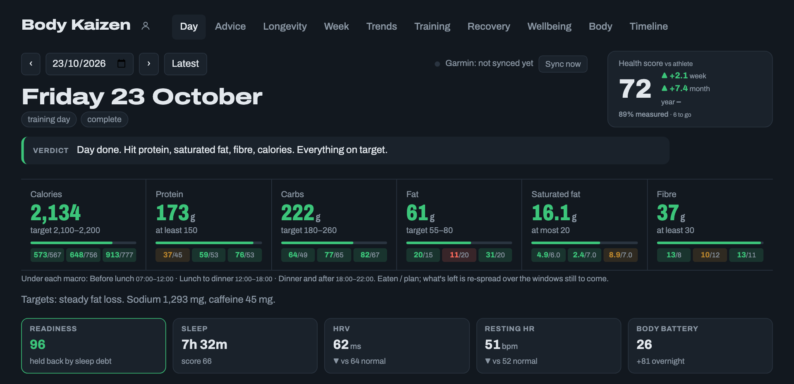
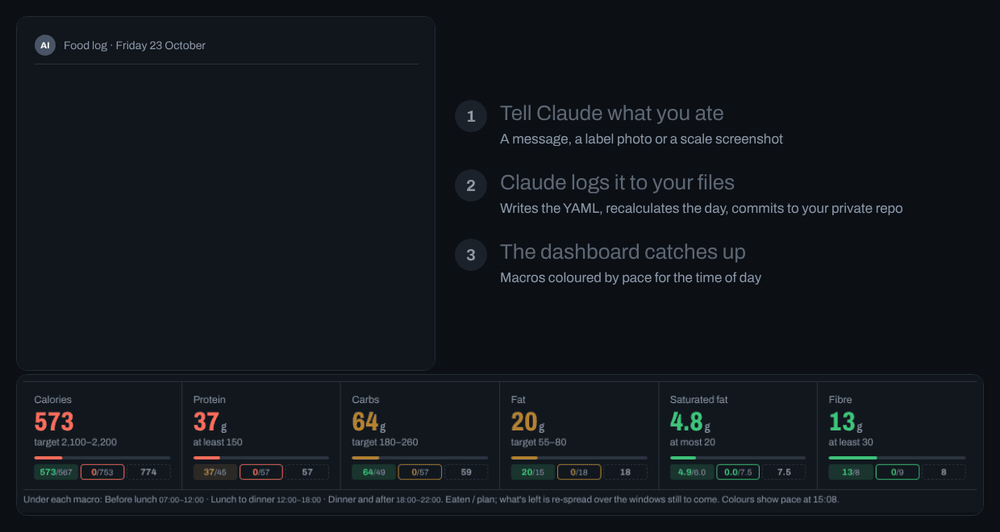
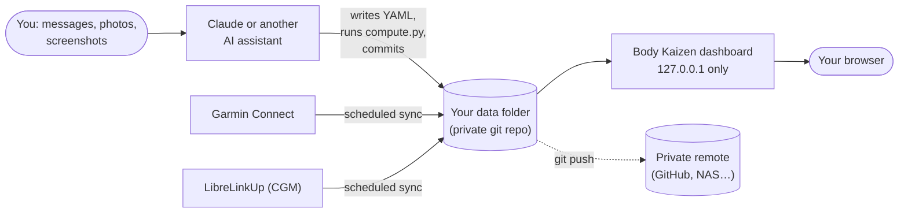
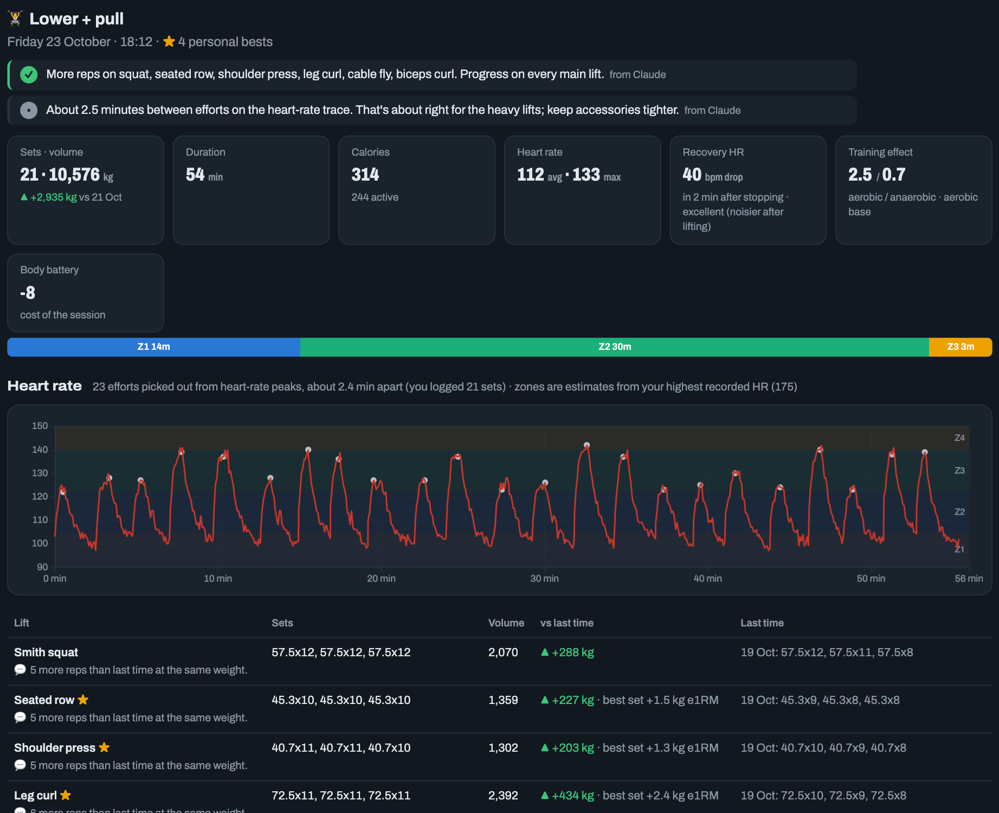
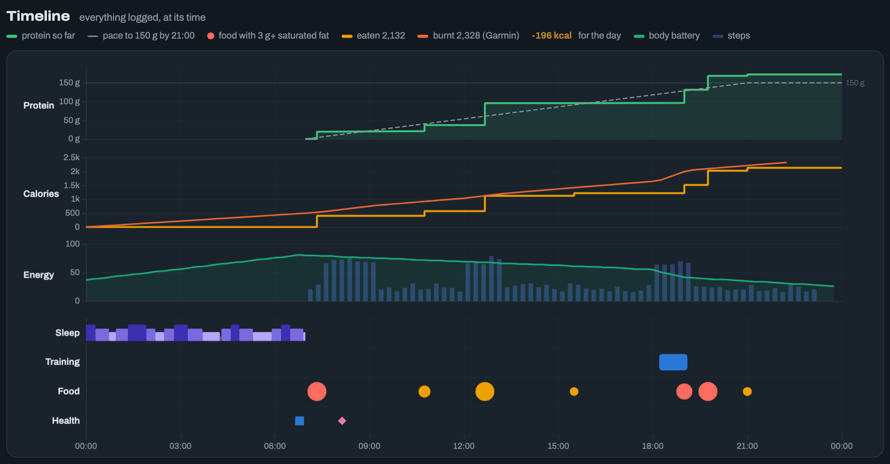
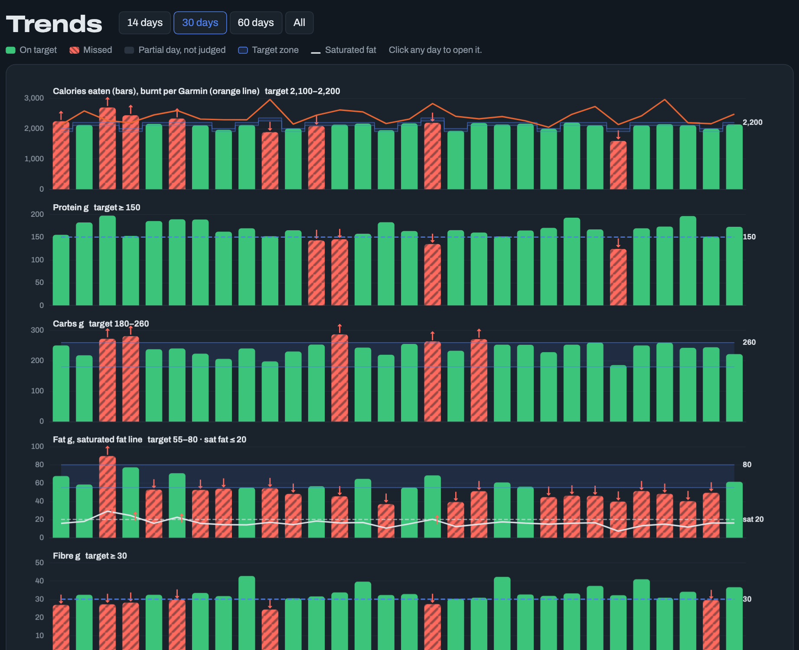
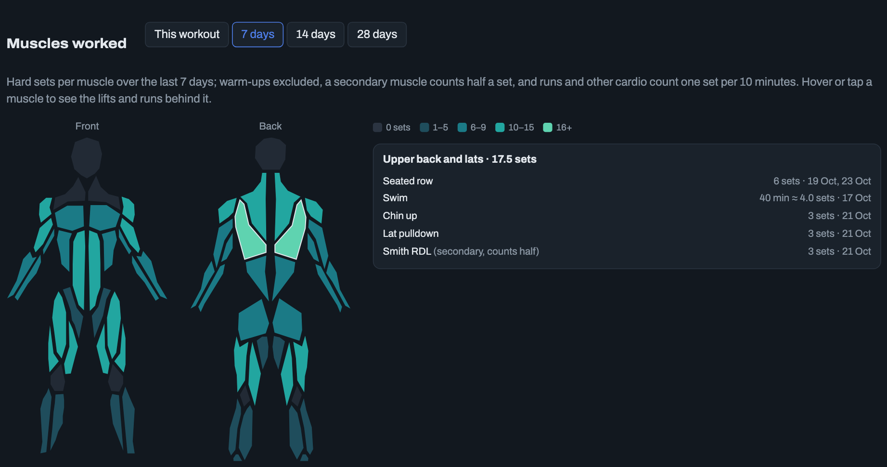
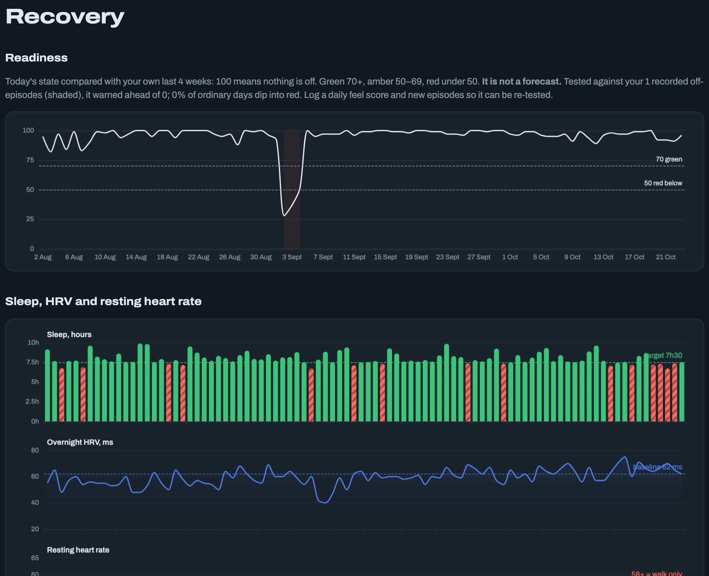
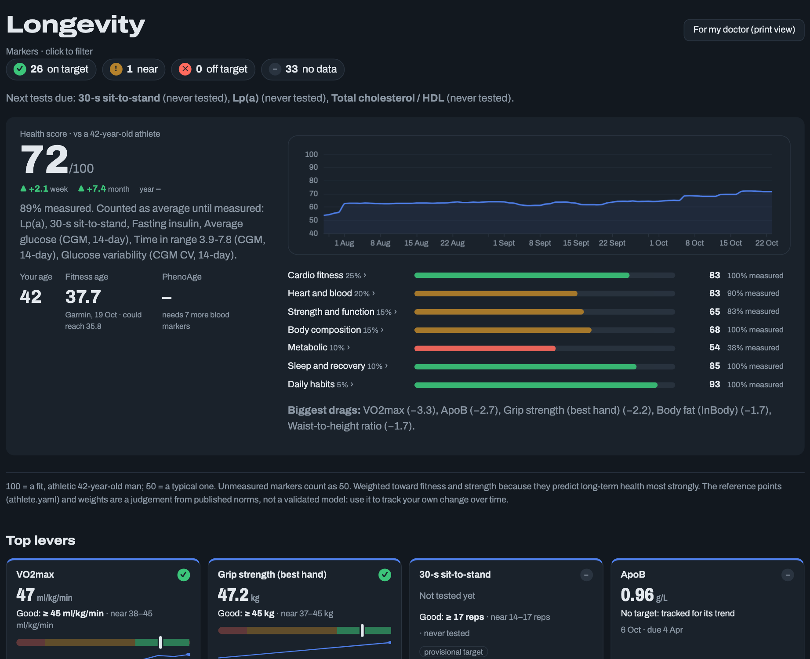

# Body Kaizen

[](https://github.com/craigbennett1981/body-kaizen/actions/workflows/ci.yml)
[](https://www.python.org/)
[](LICENSE)
[](SECURITY.md)
[](SECURITY.md)
[](#project-layout)

**A private dashboard for continuous improvement of your health.** Food, training, recovery and healthspan,
tracked as your own n-of-one experiment, in plain files you own.

You tell an AI assistant like Claude what you ate, send it a photo of a label or a screenshot of your scale, and
it writes everything into your own private git repository. Body Kaizen works out the macros, pulls in your
Garmin, glucose and gym data, and shows how your day, week and months are going against the targets you set.



> **Not medical advice, and no warranty.** Body Kaizen is a personal logging tool. Its scores, targets and
> suggestions are rules of thumb, not a diagnosis or treatment plan. Integrations are unofficial, and you're
> responsible for your own health decisions, accounts and data. Read the [Disclaimer](#disclaimer) before using it.

## Contents

[Why](#why) · [How it works](#how-it-works) · [A day with Body Kaizen](#a-day-with-body-kaizen) ·
[Features](#features) · [Quick start](#quick-start-five-minutes) · [Getting data in](#getting-data-in-you-need-an-ai-assistant) ·
[Setting up your assistant](#setting-up-your-ai-assistant) · [Practical kit](#practical-kit-whats-worth-having) · [Privacy in git](#keeping-your-data-private-in-git) · [Integrations](#integrations) · [Compared with](#compared-with-other-trackers) ·
[FAQ](#faq) · [Roadmap](#roadmap) · [Disclaimer](#disclaimer)

## Why

*Kaizen* is the Japanese idea of continuous improvement: small changes, measured, kept if they work. Body Kaizen
applies it to one body: yours. Every meal, session, night's sleep and blood test is a data point in a long-running
experiment with a sample size of one, and the dashboard is the lab notebook.

Three beliefs shape it:

- **Logging has to be effortless, or it stops.** So you never fill in a form: you send a message or a photo, and
  an AI assistant does the bookkeeping.
- **Your health data should live with you.** Plain YAML files in a folder you own, versioned in git, readable in
  any editor in twenty years. No account, no cloud, no telemetry.
- **Good days come from good hours.** It's easier to fix lunch than to fix a day, so the dashboard shows whether
  you're on track *now*, not just whether you hit the total.

## How it works





Everything runs on your own computer. The only things that leave it are the requests you choose to make: to your
AI assistant, to Garmin and LibreLinkUp if you connect them, and to your private git remote.

## A day with Body Kaizen

**07:30.** You weigh in and send the scale app's screenshot. Claude logs weight, body fat, muscle and water, and the
readiness strip shows last night's sleep, HRV and resting heart rate against your normal.

**12:45.** "lunch: 170g rice, 165g chicken breast, 120g broccoli." Claude logs it and replies with the day so far.
On the Day page, each macro shows three chips: before lunch, lunch to dinner, dinner and after. Each is coloured by
whether you're on pace for the time of day, so 60 g of protein at noon is green, not red against 150 g.

**15:00.** A buffet lunch. You photograph three plates. Claude identifies the food, estimates portions, asks about
anything it isn't sure of, and logs it all marked as estimates. The calorie chip for lunch turns amber, and the
dinner chip shrinks to what's left.

**18:30.** Gym. You paste the Hevy workout. Claude logs every set, the Garmin sync adds the heart-rate trace, and
the Training tab shows the session with Claude's comments: what moved up, what to hold, how long you rested.



**21:30.** "Close the day." The verdict appears at the top of the Day page, and the timeline shows the whole day at
its clock times: sleep stages, meals (red dots for anything with 3 g or more of saturated fat), protein pace,
calories eaten against burnt, body battery and steps.



## Features

**Paced macros.** Calories, protein, carbs, fat, saturated fat and fibre are split across three windows. While a
day is in progress the colours show pace, and what's left is re-spread over the windows still to come.

**Claude's comments, saved with your data.** Wins, warnings and observations on each workout and each lift, shown
on the dashboard next to the numbers they're about.

**Trends you can act on.** Calories (with Garmin's measured burn), protein, carbs, fat with a saturated-fat line,
fibre and weight, every day coloured hit or miss against the target that applied that day.



**A progression planner.** Next targets for every lift from double progression (add reps, then weight), with
machine changes kept separate and temporary resets when form slips.

**A muscle map.** Front and back body diagrams shaded by hard sets per muscle, for one workout or the last 7, 14
or 28 days. Runs and other cardio count too (one set per 10 minutes). Hover a muscle to see the lifts and runs
behind it, and spot the ones you never train.



**Recovery and readiness.** Sleep stages, HRV and resting heart rate against your own baseline, body battery and
stress, combined into a readiness score that says what's holding you back.



**Longevity markers.** VO2 max, grip strength, sit-to-stand, blood pressure, lipids, HbA1c, body composition and
more, each with target bands and a retest date, rolled into a health score that shows which markers moved it.



**Fitness tests.** Grip strength, 30-second sit-to-stand, one-leg stand and waist, logged in a sentence ("grip
47/45") and tracked on the Longevity tab with target bands and a reminder when each is due again.

## Quick start (five minutes)

You need Python 3.10 or newer.

**1. See it with demo data** (about 90 days of made-up data for a fictional person):

```bash
git clone https://github.com/craigbennett1981/body-kaizen.git
cd body-kaizen
python3 -m venv .venv && .venv/bin/pip install -r requirements.txt
FT_DATA=demo .venv/bin/python app/server.py          # the demo folder is generated by tools/make_demo.py
```

Open <http://127.0.0.1:8765>. The demo opens as "Sam (demo)"; with your own data folder, the first visit asks for your
name, start date and timezone.

**2. Start your own data folder**, in its own private repository:

```bash
cp -r demo ~/body-kaizen-data && cd ~/body-kaizen-data
rm -rf days/* imports/* measurements/*                     # keep the reference files, drop the demo person
sed -i.bak '/^profile:/,/^timezone:/d' settings.yaml          # forget Sam: you'll be asked for your own details
git init && git add . && git commit -m "Start my data"
gh repo create body-kaizen-data --private --source . --push   # --private is the important part
```

Set your targets in `targets.yaml` and your defaults (timezone, the milk in your tea, what "1 scoop" means) in
`settings.yaml`. The layout is explained in [docs/data-folder.md](docs/data-folder.md).

**3. Connect your AI assistant.** Copy [docs/CLAUDE.example.md](docs/CLAUDE.example.md) into your data folder as
`CLAUDE.md`, open the folder in Claude Code, and send your first meal. For a Claude project (so you can log from
your phone) or another assistant, see [Setting up your AI assistant](#setting-up-your-ai-assistant).

**4. Run it for real:** `FT_DATA=~/body-kaizen-data .venv/bin/python app/server.py`. On a Mac,
`scripts/setup_mac.sh` installs a background service that starts the dashboard at login and runs the scheduled
syncs; undo it with `scripts/setup_mac.sh --uninstall`.

## Getting data in: you need an AI assistant

Body Kaizen has no input screens. Day-to-day logging is done by an AI assistant that can read and edit files and run
commands in your data folder: **Claude** (Claude Code, the Claude desktop app with your folder connected, or a Claude
project), or another assistant with file and shell access.

```
you:        breakfast: 52g oats with water, 2 eggs, tea
            [photo of a yogurt label]  add 146g of this + half scoop protein
assistant:  Logged. 520 kcal, 45 g protein, 5.3 g sat fat, 5.7 g fibre so far.
            Fibre is behind: add fruit this afternoon.
```

Setup takes a few minutes: see [Setting up your AI assistant](#setting-up-your-ai-assistant).

**What you can send:** meals with weights, **photos of nutrition labels and plates**, screenshots of your **scale
and blood-pressure apps**, **Hevy workouts**, InBody scans and **blood test reports**, how you feel, symptoms, notes
and corrections, or just questions ("how does this yogurt compare to my usual one?"). The full list, with examples,
is in [docs/logging-with-claude.md](docs/logging-with-claude.md).

Behind the scenes the assistant adds each item to `days/YYYY/YYYY-MM-DD.yaml` (your words in `raw`, the resolved
food and weight in `parsed`), adds new foods from label photos to `foods.yaml`, runs `scripts/compute.py`, commits
to your private data repository, and tells you where you stand.

**Without an assistant** you can edit the YAML by hand (the format is in [SCHEMA.md](SCHEMA.md)) and run
`compute.py` yourself. It works, but it's slow enough that most people won't keep it up.

**The food list.** The starter list (`foods/starter.yaml`) ships with about 200 foods, with macros per 100 g, aliases, and a note where figures
come from a product label. It leans towards Asian and Western home cooking. Add your own in your data folder's `foods.yaml`; yours win.

**Think about what you share.** Your assistant reads your health data. Pick a provider you're comfortable with and
check its data-retention settings.

## Setting up your AI assistant

Two files tell the assistant what to do:

| File | Where it lives | What it's for |
|---|---|---|
| [`AI-GUIDE.md`](AI-GUIDE.md) | the code, same for everyone | The full brief: the logging loop, every kind of input and which file it goes in, how to handle foods it can't match, coach comments on workouts, the integrations, how to reply, and the rules (never hand-edit totals, never store ID numbers, don't diagnose). |
| `CLAUDE.md` | your data folder, yours to edit | You: your training pattern, habits, goal and the tone you want. Start from [`docs/CLAUDE.example.md`](docs/CLAUDE.example.md). It tells the assistant to read `AI-GUIDE.md` first, and anything in it overrides the guide. |

With those two, a brand-new assistant knows the whole system from its first message, and every chat logs the same way.

### Option A: Claude Code (simplest)

1. Copy `docs/CLAUDE.example.md` into your data folder as `CLAUDE.md`. Set `FT_CODE` to where you cloned
   Body Kaizen, and fill in the parts in `<angle brackets>`.
2. Open the folder: `cd ~/body-kaizen-data && claude`. Claude Code reads `CLAUDE.md` on its own.
3. Send your first meal.

### Option B: a Claude project (log from your phone too)

1. In the Claude app, create a project, for example "Food tracker".
2. Paste your edited `CLAUDE.md` into the project's **instructions**.
3. Add `AI-GUIDE.md` and `SCHEMA.md` to the project's **files**. The project can't see your code folder, so it
   needs its own copy. Re-add them when you update Body Kaizen.
4. Give the project's chats access to your data folder (for example through the Claude desktop app on the computer
   where the folder lives), so Claude can edit the files and run `compute.py`. Without folder access it can only
   tell you what to write.
5. Start a chat in the project and send your first meal. Every chat in the project shares the same instructions,
   so you can log from your phone and see the result on the dashboard at home.

### Option C: another assistant

Anything that can edit files and run commands works. Give it `AI-GUIDE.md` plus your edited `CLAUDE.md`, under
whatever name that tool reads (often `AGENTS.md`).

### Starting from an empty data folder

Your first message can simply be *"Set me up."* The guide tells the assistant to copy `demo-template/`, then ask
for your name, start date, timezone, age and sex, targets and usual foods, and to write them into
`settings.yaml`, `athlete.yaml`, `targets.yaml` and `meals.yaml`. It suggests a private git repository for the
folder, and leaves the integrations until you ask for them.

### Good habits

- **Send things as they happen.** Partial days are fine. Say "close the day" at the end.
- **Weigh food when you can.** Guesses are marked as guesses, and the Day page shows what share of your calories
  came from them.
- **Tell it what training you're doing today.** It changes the calorie target.
- **Put repeat habits in your files, not your messages:** the milk in your tea goes in `settings.yaml`, your usual
  breakfast in `meals.yaml`.
- **Correct it in plain words** ("that was 3 sets, not 4"). Fixes to food matching are saved so they stay fixed.

## Practical kit: what's worth having

None of this is required: you can start with your phone and an AI assistant. But the dashboard is only as good as
what goes into it, and a few tools make a big difference. In rough order of value:

### 1. A kitchen scale (the one that matters most)

Guessed portions are often out by a third or more, especially for rice, pasta, oils, nuts and meat. A **digital
kitchen scale that reads to 1 g, with a tare button** removes most of that error and makes logging faster:
put the bowl on, tare, add the food, read the number.

- Weigh food **as you eat it** (cooked), and say so if a weight is raw or dry. Your default lives in `settings.yaml`.
- For bone, skin or leftovers, weigh what's left and send it ("bones 52g"); it's taken off.
- Eating out you can't weigh: send a photo. It's logged as an estimate and the Day page shows how much of your
  day was guessed.

### 2. A Garmin watch (recovery, sleep and training load without typing)

With the [Garmin sync](docs/integrations.md#garmin-connect) on, these arrive on their own several times a day:
**sleep** (duration, stages, score), **overnight HRV** and **resting heart rate**, **body battery**, **steps**,
**VO2 max estimate**, and every **workout** with its heart-rate trace and calories. That's what drives the
Readiness and Recovery views, the training-load chart and the daily calorie target on training days.

- Wear it to sleep. Most of the recovery picture comes from the night.
- Wrist heart rate is fine for steady cardio but lags in intervals and lifting. A **chest strap** fixes that if
  you care about gym heart rate.
- The calorie figures are estimates. Body Kaizen uses them for trends and day type, not as exact numbers.
- Other watches work if you log the key numbers (sleep, resting HR, HRV) by message, but only Garmin syncs today.

### 3. A continuous glucose monitor (optional, eye-opening for a few weeks)

A **FreeStyle Libre** sensor read through [LibreLinkUp](docs/integrations.md#abbott-librelinkup-continuous-glucose)
gives every timed meal a glucose curve: the rise, the peak, and how long until you're back to baseline. A few
two-week sensors are usually enough to learn which of your regular meals spike you and whether a walk after eating
helps. You don't need to wear one all the time.

- Give meals a time ("L 13:10: …") so they line up with the curve.
- Rules on whether you need a prescription vary by country. If you have diabetes, follow your care team's
  advice, not this dashboard.

### 4. A body-composition scale

A smart scale that also estimates **body fat and muscle** (bioimpedance) gives you a morning weigh-in in one
screenshot. The fat and muscle figures can be off by a few percent and move with hydration, so read the
**trend**, not the day. Weigh at the same time each morning, after the bathroom, before food. An occasional
**InBody** or **DEXA** scan is a good cross-check; send the printout.

### 5. A blood-pressure monitor

An **upper-arm** cuff (not wrist) from a model validated for accuracy. Sit for five minutes first and take two
readings a minute apart; readings within five minutes are averaged as one session. Morning and evening readings
are tracked separately.

### 6. Small extras

- **A tape measure** for waist circumference: one of the most useful long-term markers.
- **A grip dynamometer** for grip strength, a cheap and well-studied marker of healthy ageing.
- **[Hevy](docs/integrations.md#hevy)** or any gym log, so sets and weights come in without typing.
- **Regular blood tests** through your doctor (lipids, HbA1c and so on), photographed or sent as PDFs.

### What to expect

The tracking takes a few minutes a day once it's a habit: weigh, send, glance at the reply. Give it
**two to four weeks** before judging anything; most of the value is in trends, and in noticing patterns you
couldn't see before.

## Keeping your data private in git

Your food, weight, blood pressure, glucose, lab results and notes are health data. Keeping them in git gives you
history and backups, but only if the repository stays private.

- **Keep your data in its own repository, separate from this code.** Never commit it into a fork or clone of Body
  Kaizen: if you ever make that public, or open a pull request from it, your data goes with it.
- **Make the data repository private** on GitHub (or GitLab, or a bare repo on your own disk or NAS) *before* the
  first push. Check the visibility again if you ever transfer or rename it.
- **Deleting a file doesn't remove it from git.** Every past version stays in the history. If health data is ever
  pushed somewhere public, deleting it isn't enough: rewrite the history (for example with `git filter-repo`) or
  delete the repository, and assume it has been copied.
- **Credentials never go in either repository.** Garmin tokens live in `~/.garminconnect`, the LibreLinkUp password
  in your system keychain. Don't commit `.env` files or tokens.
- **Watch what you photograph.** Lab reports and body-composition printouts often show ID numbers and dates of
  birth. Log the results, not those fields.
- **Sharing a bug report?** Use the `demo/` data to reproduce it. Never paste real day files or logs into a public
  issue.

## Integrations

All optional: the dashboard works with nothing but logged meals. Each integration writes into your data folder and
never overwrites what you or your assistant logged (sets, notes, effort, a treadmill's belt distance).

| Source | What it adds | How it gets in |
|---|---|---|
| **Garmin Connect** | Steps through the day, calories burnt, sleep with stages and score, overnight HRV, resting heart rate, body battery, stress; every activity with its heart-rate trace, zones, training effect and recovery heart rate; VO2 max and fitness age | Pulled automatically four times a day (08:00, 13:00, 19:00, 22:00) and on "Sync now" |
| **Abbott LibreLinkUp** | Continuous glucose from a FreeStyle Libre sensor, drawn on the Day timeline next to your meals | Pulled automatically every 30 minutes |
| **Hevy** | Gym sessions with every set, matched to your lifts for progression and personal bests | Paste the workout text to your assistant; for history, import Hevy's CSV export with `scripts/hevy_import.py` |
| **Smart scales** | Weight, body fat, muscle, visceral fat, body water, BMR | Screenshot of the scale's app, read by your assistant |
| **Blood-pressure monitors** | Systolic, diastolic and pulse, with time of day | Screenshot of the monitor's app, read by your assistant |
| **InBody and lab reports** | Body-composition scans and blood results, with target bands on the Longevity tab | Photo or PDF, read by your assistant into `measurements/` |

Setup for Garmin and LibreLinkUp is a one-time login:

```bash
.venv/bin/python scripts/garmin_login.py     # password + MFA; token kept in ~/.garminconnect
.venv/bin/python scripts/libre_login.py      # email kept in ~/.body-kaizen/libre.json, password in your keychain
```

Garmin and LibreLinkUp have no public personal-data API, so these syncs use the community libraries
[`garminconnect`](https://github.com/cyberjunky/python-garminconnect) and
[`pylibrelinkup`](https://github.com/robberwick/pylibrelinkup). They're **unofficial**: not endorsed by Garmin or
Abbott, use at your own risk, and they can break whenever those services change. Glucose data is for interest, never
for treatment decisions. Full details: [docs/integrations.md](docs/integrations.md).

## Compared with other trackers

A rough guide to where Body Kaizen fits; the other products change often, so check their current terms.

| | **Body Kaizen** | Calorie-counting apps (MyFitnessPal, Cronometer) | Apple Health / Google Health Connect |
|---|---|---|---|
| Where your data lives | Plain files on your computer, in your own git repo | The company's cloud, behind an account | On your phone (plus the company's cloud backup) |
| How you log food | Chat and photos to an AI assistant | Search, barcode scan, recent foods | Through other apps |
| Coaching | Your assistant, in your words, with your history | Generic targets and summaries | None |
| Garmin depth | Sleep stages, HRV, body battery, per-workout heart-rate traces | Mostly calories burnt | Varies by app |
| Training and longevity | Lift progression, fitness tests, lab markers, health score | Little or none | Raw data, few views |
| Cost | Free and open source (you pay for your AI assistant) | Free tier, paid subscription for more | Free with the phone |
| Best for | People who want full control and like a bit of setup | Quick, mainstream calorie counting | Collecting data from many apps |

## FAQ

**Do I have to use Claude?** No. Any assistant that can edit files and run commands works, and you can edit the
YAML by hand. The docs use Claude because that's what it was built and tested with.

**Does it work without a Garmin?** Yes. Food, weight, blood pressure, gym logs and lab results all work without a
watch. You lose the sleep, HRV, body-battery and heart-rate views.

**Mac only?** The dashboard is plain Python and runs anywhere Python 3.10 does. Only the background-service
installer (`setup_mac.sh`) is Mac-specific; on Linux or Windows, start the server yourself or with your own service
manager.

**Where do my name and timezone come from?** The first time you open the dashboard it asks for your name, the date you
started tracking, and your timezone (detected from your computer), and saves them in your data folder's
`settings.yaml`. Click your name in the header to change them.

**What does it cost?** Nothing. Your AI assistant's subscription is the only running cost, and you'd likely have
it anyway.

**Can my family use it?** Each person needs their own data folder; run one dashboard per folder, on different
ports (`FT_PORT=8766`).

**Is my data used to train anything?** Body Kaizen sends nothing anywhere. What your AI assistant does with your
messages depends on its provider's settings; check them.

## Roadmap

- Units: imperial (lb, oz) as an option
- More importers: Apple Health export, Oura, Withings, Strava
- A mobile-friendly Day page layout
- Weekly review generated into `reviews/`
- Packaging: `pipx install body-kaizen`

Ideas and pull requests are welcome: see [CONTRIBUTING.md](CONTRIBUTING.md).

## Project layout

```
app/          dashboard server (server.py) and one module per tab; static/ holds the page
scripts/      compute.py, food resolution (nutrition.py), sync and import scripts, Mac setup
tools/        make_demo.py, which generates the demo/ folder
foods/        starter.yaml, the starter food database
demo/         made-up data folder for trying it out
docs/         setup guides, the CLAUDE.md template and screenshots
tests/        smoke tests run in CI
SCHEMA.md     the data format
AI-GUIDE.md   the brief for your AI assistant: every input, where it goes, how to reply
```

## Disclaimer

Body Kaizen is provided **as is, without warranty of any kind** (see [LICENSE](LICENSE)). By using it you accept the
following.

**You are responsible for your own use of it.** You choose what to track, which services and AI assistant to
connect, where your data is stored and who can see it, and what you do with what the dashboard shows you. Those
decisions, and their consequences for your health, your accounts and your data, are yours alone. The authors and
contributors are not responsible for them.

**The AI assistant is a separate service.** Body Kaizen contains no AI. The assistant you connect is what reads
your messages and photos, identifies foods, estimates portions, adds new foods and their macros, writes coach
comments, and gives you feedback and advice. Body Kaizen then adds up whatever the assistant wrote and draws it.
So the accuracy of the food breakdowns, estimates and advice depends on that assistant. It is provided by its own
company under that company's terms, and Body Kaizen's authors and contributors are not responsible for anything
it says or does. AI assistants make mistakes, sometimes confidently: check what yours logs, and treat its advice
as a suggestion, not a verdict.

**Health.** Nothing Body Kaizen shows is medical advice. Scores, targets, readiness, "next move" lines and
suggestions, including anything an AI assistant tells you while logging, are rules of thumb that can be wrong.
Glucose, blood pressure and lab values are shown for interest, never for diagnosis or treatment decisions. Talk to a
doctor before changing your diet, training, medication or supplements, and about any reading that worries you.

**Integrations.** The Garmin Connect and LibreLinkUp syncs use unofficial, community-maintained libraries. They are
not endorsed by, affiliated with, or supported by Garmin, Abbott, Hevy or any other company named here. Using them
may be against those services' terms of use and could, in principle, get your account rate-limited, locked or
suspended. They can stop working, or return wrong or incomplete data, without notice whenever those services
change. All trademarks belong to their owners.

**Security.** You are responsible for keeping your data and accounts secure:

- the dashboard is built to run on your own computer and has **no login or access control**. Don't expose it to a
  network or the internet (it binds to `127.0.0.1` for this reason);
- login tokens and passwords for the integrations live on your computer (`~/.garminconnect`, your system
  keychain). Anyone with access to your user account can use them;
- an AI assistant you give access to your data folder can read, change and delete anything in it, and what you send
  it is handled under that provider's terms and retention policy;
- keep your data repository **private**; see [Keeping your data private in git](#keeping-your-data-private-in-git).

**Loss of data.** Your data is only as safe as your backups. Syncs, imports, `compute.py`, an AI assistant or a bug
in Body Kaizen can overwrite, mis-file or delete entries, and the services you sync from can lose or change data
too. Keep your data folder in git, commit often, push it to a **private** remote or another backup, and check what
your assistant changes. The authors accept no liability for lost, corrupted, leaked or incorrect data, or for any
decisions made using it.

## Contributing

Body Kaizen is a maintained project and contributions are welcome: bug fixes, new foods, docs, views, integrations
and better instructions for AI assistants. Start with [CONTRIBUTING.md](CONTRIBUTING.md): what fits, how to set up,
and what a pull request needs. For anything big, open an issue first so we can agree the approach. Questions and
show-and-tell go in Discussions. Everyone follows the [Code of Conduct](CODE_OF_CONDUCT.md).

**Never include your own health data in an issue or pull request**; use the demo data to reproduce problems.

## Licence

Apache License 2.0. See [LICENSE](LICENSE) and [NOTICE](NOTICE). Bundled third-party files keep their own licences:
ECharts (Apache 2.0) and the Archivo font (SIL Open Font License 1.1), both in `app/static/vendor/`.
