# What's on each page

Every tab of the dashboard, what it shows and how to read it. Screenshots are from the demo data (Sam, a made-up
person). To click around yourself, open the [live demo](https://demo.bodykaizen.app/). The screenshots are made
from the demo by `tools/readme_media.py`, so they show the current code.

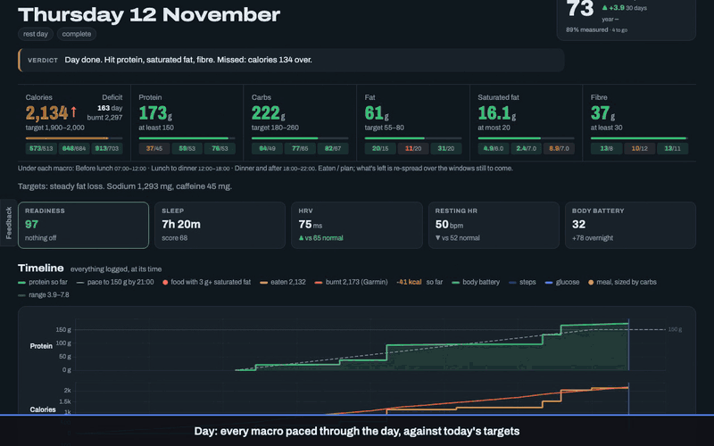

- [A day with Body Kaizen](#a-day-with-body-kaizen)
- [Day](#day) · [Food](#food) · [Sleep & recovery](#sleep--recovery) · [Experiments](#experiments) · [Training](#training) ·
  [Body](#body) · [Week](#week) · [History](#history) · [Longevity](#longevity) · [Everything else](#everything-else)

## A day with Body Kaizen

**07:30.** You weigh in and send the scale app's screenshot. Claude logs weight, body fat, muscle and water, and the
readiness strip shows last night's sleep, HRV and resting heart rate against your normal.

**12:45.** "lunch: 170g rice, 165g chicken breast, 120g broccoli." Claude logs it and replies with the day so far.
Each macro on the Day page shows whether you're on pace for the time of day, so 60 g of protein at noon is green,
not red against 150 g.

**15:00.** A buffet lunch. You photograph three plates. Claude identifies the food, estimates portions, asks about
anything it isn't sure of, and logs it all marked as estimates.

**18:30.** Gym. You paste the Hevy workout. Claude logs every set, the Garmin sync adds the heart-rate trace, and
the Training tab shows the session with Claude's comments: what moved up, what to hold, how long you rested.

**21:30.** "Close the day." The verdict appears at the top of the Day page, and the timeline shows the whole day at
its clock times.

## Day

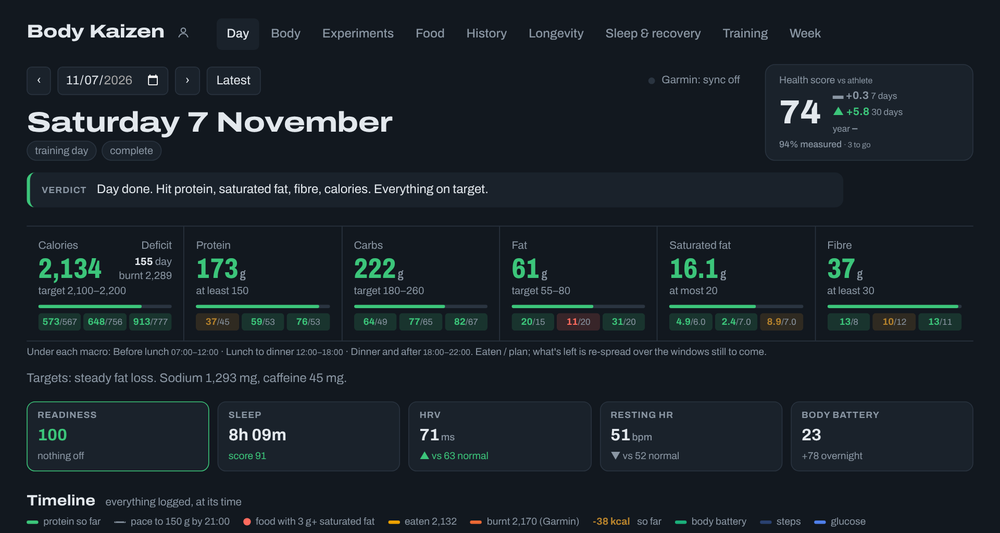

**Paced macros.** Calories, protein, carbs, fat, saturated fat and fibre, each split across three windows: before
lunch, lunch to dinner, dinner and after. While a day is in progress the colours show pace, and what's left is
re-spread over the windows still to come.

**Energy balance.** The Calories box shows your deficit so far (Garmin's burn to the last sync minus what you've
eaten) and the deficit you're heading for today: burn projected to midnight minus your target, or what you've eaten
if that's more. Hover for the sums.

**The timeline.** The whole day at its clock times: sleep stages, meals (red dots for anything with 3 g or more of
saturated fat), protein pace, calories eaten against burnt, body battery and steps, and, with a FreeStyle Libre, the
glucose curve with each meal marked on it.

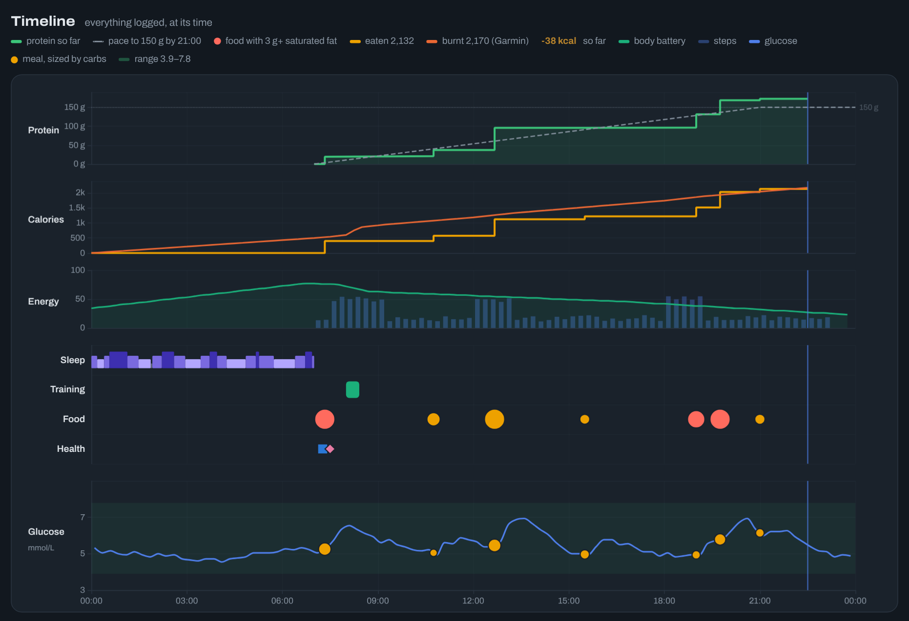

**Glucose against every meal.** With a Libre connected, each timed meal gets its rise, peak and time back to
baseline. The Body tab adds a 14-day profile and your meals ranked by spike.

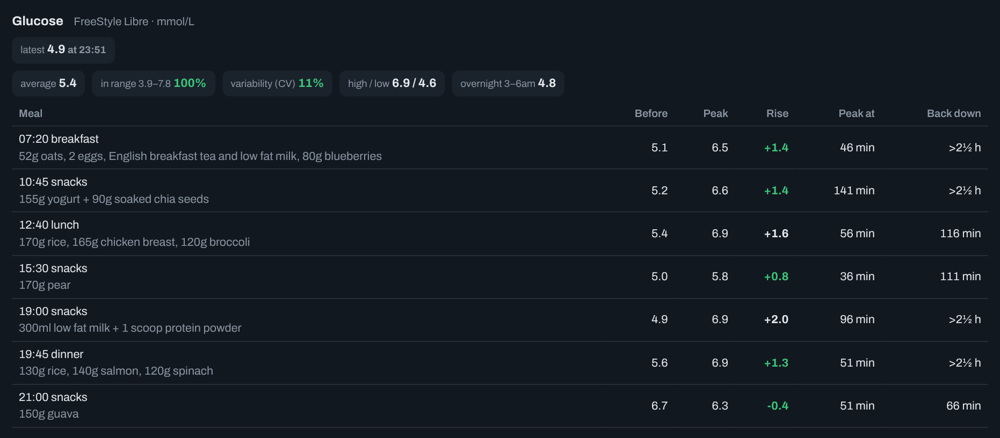

## Food

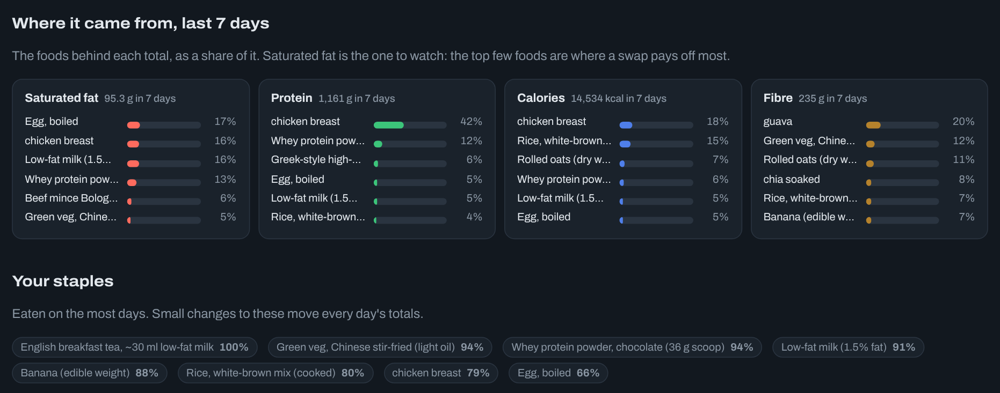

- **Where it came from:** the foods behind this week's saturated fat, protein, calories and fibre, as a share of
  each. The top few are where a swap pays off most.
- **Staples:** the foods on the most days, because small changes there move every day's totals.
- **Plants this week:** how many different plants you ate in the last 7 days, against 30, with the last 8 weeks. A
  food counts as a plant from its section and name; set `plant: true` or `plant: false` on it to overrule that.
- **Swaps for your saturated fat:** for the week's biggest sources, foods you already eat with at least as much
  protein per calorie and under half the saturated fat, and what the swap would have saved.
- **Your meals on an average day:** what breakfast, lunch, snacks and dinner each supply.
- **Weekdays and weekends:** daily averages against your targets.
- **Glucose by food:** with a CGM, the median rise after meals that included each food.
- **Every food:** a searchable, sortable table of everything you've logged, with macros per 100 g, protein per
  100 kcal, how often and how much, all time or the last 7 days.

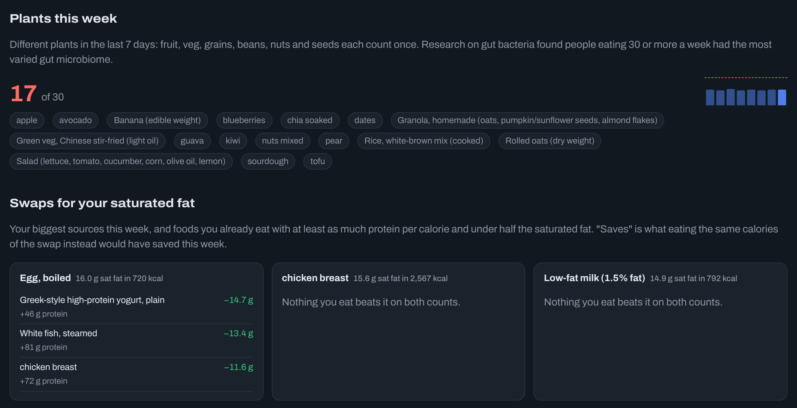

**Glucose** (with a CGM): the last 14 days' average, time in range, variability and estimated HbA1c, a 24-hour
profile, and what raised it, ranked by food (the median rise after meals that included it) or by meal. A day-by-day
table sits underneath.

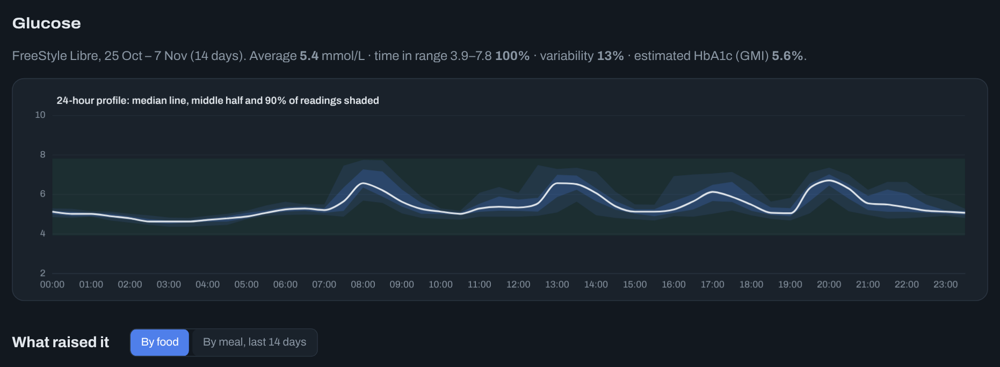

## Sleep & recovery

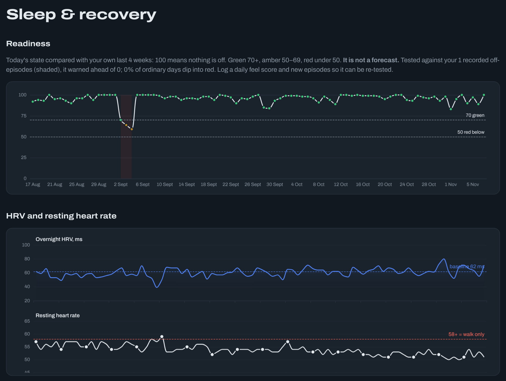

- **Readiness:** today's state against your own last 4 weeks (resting heart rate, HRV, sleep debt, training load,
  stress, body battery), saying what's holding you back. It's tested against your recorded off episodes and says
  how often it warned ahead.
- **HRV and resting heart rate** every night against your baseline, with the resting heart rate at which the day
  should be a walk only.

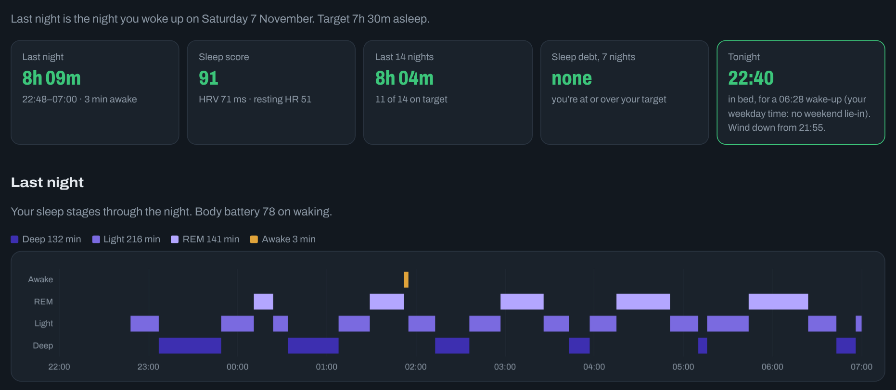

- **Last night:** time asleep, score, HRV and resting heart rate, oxygen and breathing, and a chart of your stages
  through the night.
- **Tonight:** when to be in bed, worked back from your usual weekday alarm, your target, how long you're usually
  awake in the night and time to fall asleep. It always uses the weekday alarm, so it never builds in a lie-in.
- **Every night:** time asleep against your target and Garmin's sleep need, and your sleep debt over 7 nights.
- **Sleep stages:** deep, REM and light sleep as a share of the night against typical adult ranges, how each
  changes with short nights, late sessions and late bedtimes, and the hours you tend to wake.
- **When you sleep:** a bar per night from falling asleep to waking, so you can see how regular you are and how far
  weekends drift.
- **What goes with better and worse nights:** your own nights split by the day before (a session after 19:00, a
  late meal, caffeine after 2 pm, a busy or stressful day, weekends), each with a verdict and the difference in
  sleep, score, HRV and bedtime. They show what goes together, not proof of cause, and small splits are marked.
- **Advice:** rules on your own numbers first (each says what it saw), then the general sleep habits with the best
  evidence.

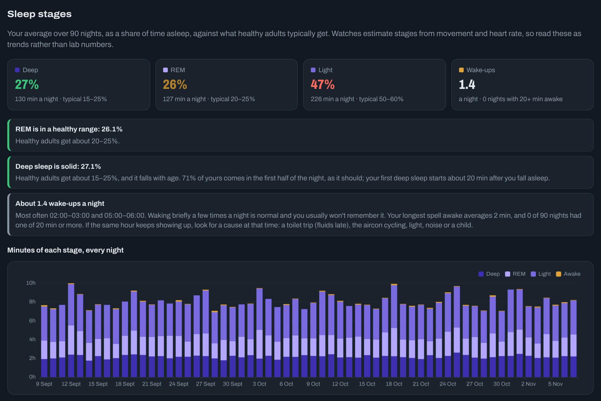

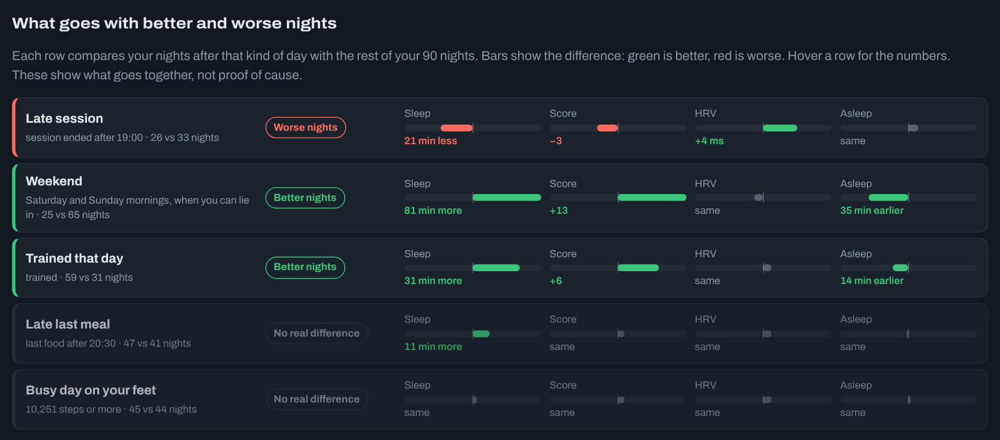

## Experiments

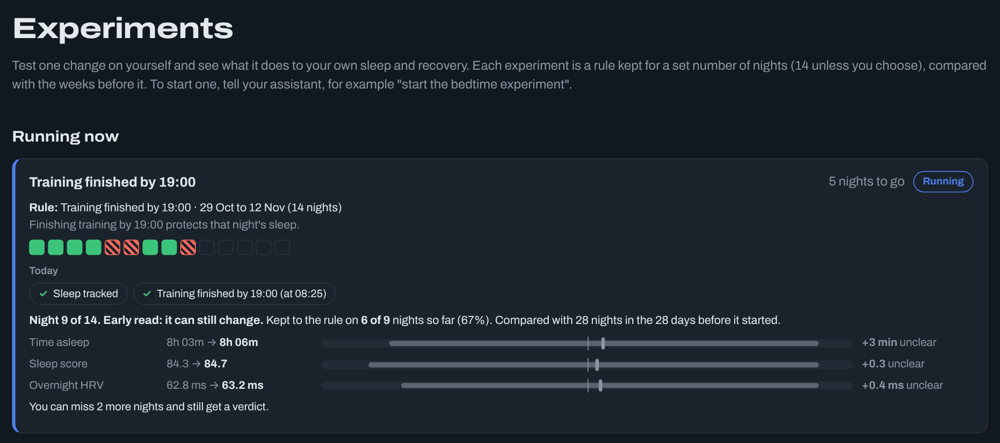

Test one change on yourself and see what it does to your own sleep, recovery, blood pressure or weight.

- **Worth testing:** patterns your nights already show (late sessions, late meals, caffeine, bedtime), each with
  the evidence so far and the test that would settle it. Tell your assistant "start the bedtime experiment" and
  it adds it to `experiments.yaml`.
- **Two kinds:** a night experiment (a rule each evening, judged on that night's sleep) and a period experiment (a
  daily habit for a few weeks, like "beetroot every day for 21 days", judged on morning blood pressure, weight or
  sleep, with the first few days left out while any effect builds).
- **Running now:** the rule, a square for each day or night (kept, missed or still to come), an early read on each
  outcome against the weeks before, and today's checklist: the readings it needs (a morning blood pressure, a
  weigh-in, the watch worn overnight) and the rule. Anything not done by its time comes up as a reminder toast.
- **Progress:** days or nights to go, how many more you can miss and still get a verdict (or a warning when it can't
  reach one any more), and early results shown as a lean, not a verdict. A toast at the halfway point says how it's
  going.
- **Look for a relationship:** does more of one thing go with a higher or lower reading some days later? Pick a
  food, amount or daily total, a reading, a delay and an averaging window, and get a scatter chart with the
  correlation and its 90% range, before committing to a test.
- **Try a rule:** pick any variable, a comparison and a value ("asleep by 22:30", "dinner carbs under 60 g", "had
  magnesium") and see how your nights went when it held against when it didn't, with a button to turn it into an
  experiment. Nothing is saved.
- **What you can test:** the full list of variables: the night's sleep, the day before's food, timings, training,
  steps and stress, any food or supplement you log, and habits no device records (like when your screens went off),
  which your assistant logs from chat. Anything outside the list is flagged, not silently ignored. Length is 14
  nights unless you choose otherwise (3 to 60).
- **Finished:** a verdict per experiment: it worked, no clear effect, made it worse, not enough kept, or "could be
  a trend" when the reading was already moving that way before the start. A toast tells you when one finishes, the
  card says what to do next, and a button copies the result for your assistant to write up in the experiment's notes.
  Each outcome shows the difference with a 90% range from resampling, and only counts as better or worse when the
  whole range is on one side of zero.

## Training

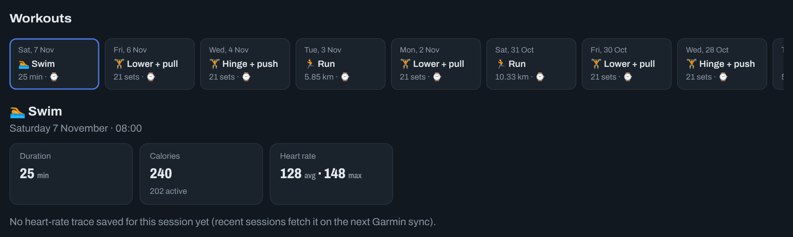

- **Every session** with Claude's comments, the Garmin heart-rate trace with each effort marked, and every lift
  against last time.
- **A progression planner:** next targets for every lift from double progression (add reps, then weight), with
  machine changes kept separate and temporary resets when form slips.
- **A muscle map:** front and back diagrams shaded by hard sets per muscle, for one workout or the last 7, 14 or 28
  days. Hover a muscle for the lifts and runs behind it.
- **An activity calendar:** a year of sessions, GitHub-style, each day shaded by calories burnt.

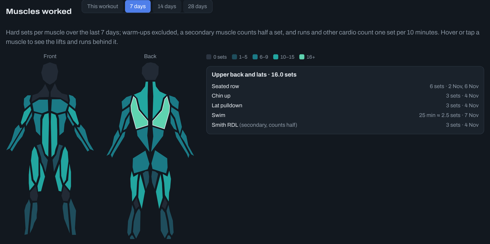

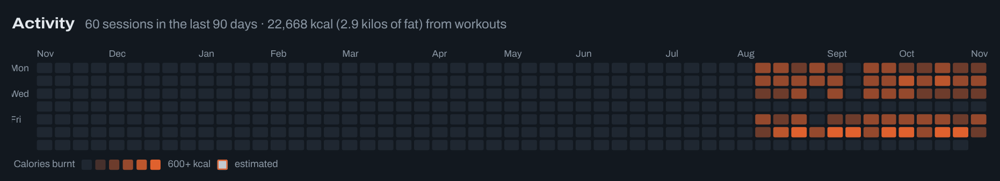

## Body

**Weight** with a 7-day trend. **Body composition:** a small chart for every measure your scale gives (fat mass,
muscle, fat-free mass, visceral fat, water, BMR and more), each with its 30-day change and InBody scans alongside.
**Energy balance:** 30 days of burnt minus eaten, and the weight change it should have caused against your actual
trend. **Blood pressure** on the 2017 ACC/AHA bands, with pulse pressure.

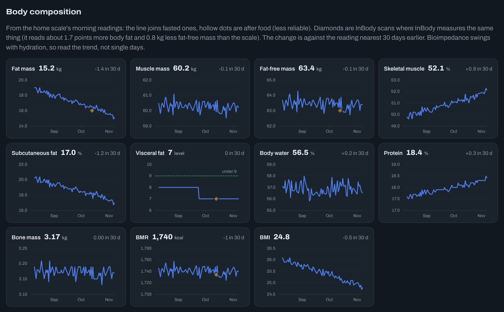

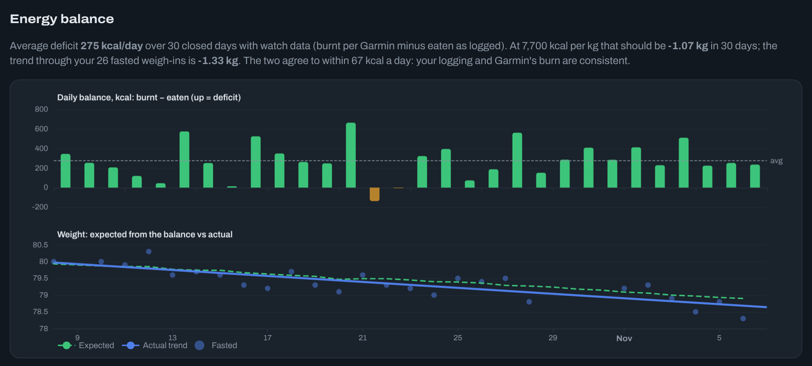

## Week

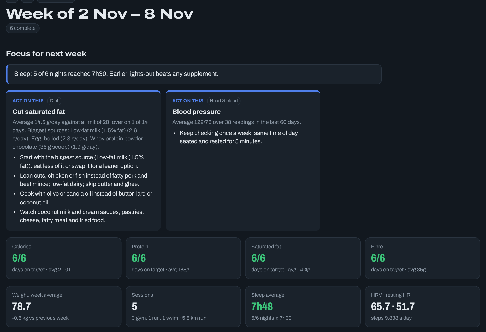

One week at a glance, and the place to check on a Sunday. Use the arrows to go back a week.

- **Focus for next week,** with the top changes the advice picks from your own data.
- **Tiles:** days on target for calories, protein, saturated fat and fibre, the week's average weight, sessions,
  sleep, HRV and steps.
- **Trends:** calories (with Garmin's measured burn), protein, carbs, fat with a saturated-fat line, fibre and
  weight over 14, 30 or 60 days or all time, every day coloured hit or miss against the target that applied that
  day. Click a day to open it.
- **Habits** against their targets, the **last 12 weeks** as a grid of days, **new bests** and a table of the
  **days**.
- **All advice,** by area (diet, heart and blood, training, sleep and recovery, body, lifestyle), each saying what
  it saw in your last 2–4 weeks and what to do.

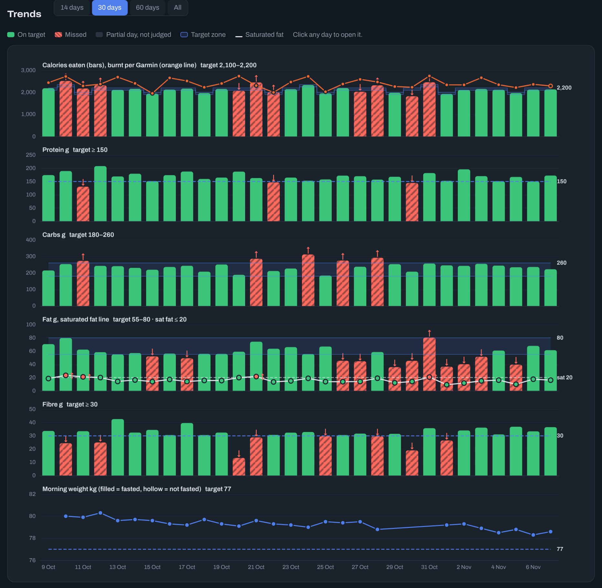

## History

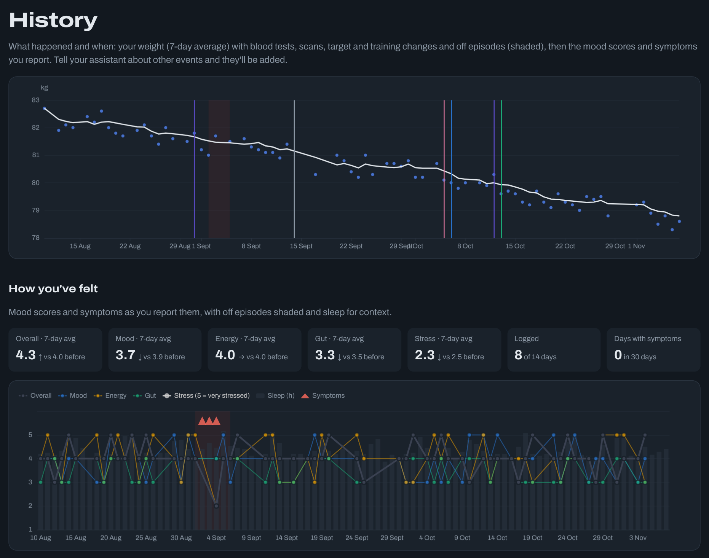

What happened and when. Your weight (7-day average) with blood tests, scans, target and training changes and off
episodes marked on it, the mood, energy, gut and stress scores and symptoms you report, with sleep alongside, and
every event by month. Tell your assistant about other events (a trip, an illness, a new supplement) and they're
added.

## Longevity

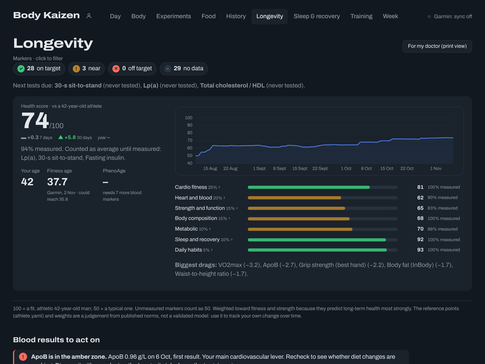

VO2 max, grip strength, sit-to-stand, blood pressure, lipids, HbA1c, body composition and more, each with target
bands and a retest date, rolled into a health score that shows which markers moved it. Fitness tests are logged in a
sentence ("grip 47/45").

## Everything else

- **How your numbers are judged**, linked at the foot of every page: each target, band and score and the guideline
  or study it comes from ([docs/thresholds.md](thresholds.md)).
- **Set up from the browser:** on first run the dashboard asks where to keep your data, and **Connections** logs
  you in to Garmin and LibreLinkUp.

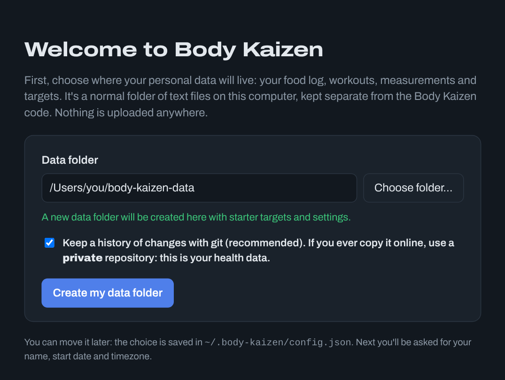
