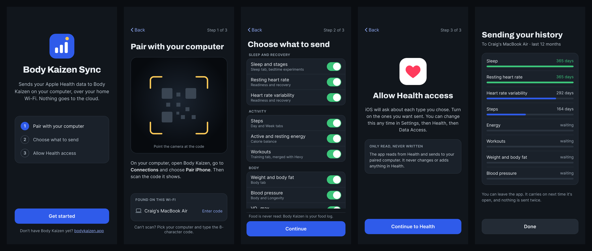
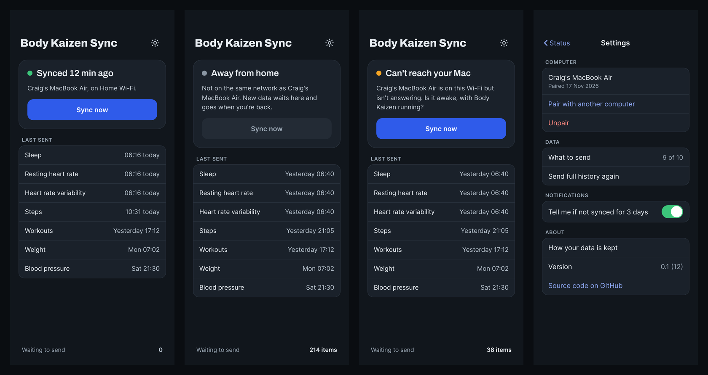
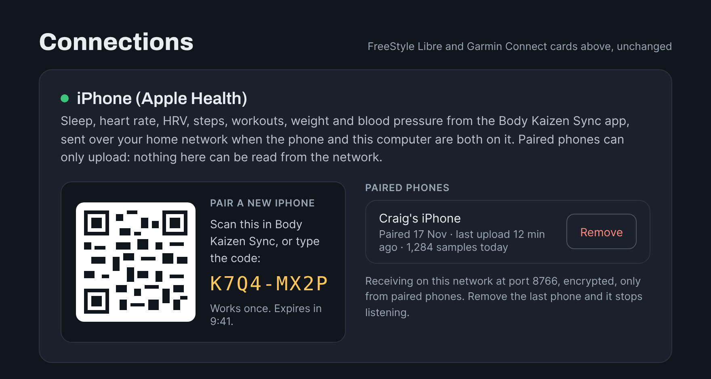

# iPhone sync: Apple Health into Body Kaizen (design)

Status: design agreed 17 Nov 2026, not built. Owner: Craig.

## Goal

A small iPhone app, **Body Kaizen Sync**, that reads Apple Health and sends it straight to the Body Kaizen running
on your Mac when both are on the same home network. No cloud, no iCloud setup, no server to run: the Mac is the
server. Pair once with a QR code, then it syncs on its own.

It reads only what Body Kaizen uses (about 15 types), thins it on the phone, and the Mac translates it into the
same records Garmin data becomes, so the dashboard looks the same whichever watch you wear.

Not goals: logging food or workouts in the app (the assistant and Hevy do that), showing a dashboard on the phone,
syncing away from home, or Android.

## How it fits together

```
iPhone                                         Mac (Body Kaizen)
HealthKit ─► about 15 types ─► thinned ─► outbox ──TLS, pinned──► sync receiver (LAN, upload only)
  ▲ background delivery        (per-minute HR,  (held until the       │
  │                             15-min steps)    Mac is reachable)    ▼
  └── user grants each type                          Apple adapter ──┐
                                                     Garmin adapter ─┼─► Body Kaizen records (one format)
                                                                     ▼
                                                     day files ──► dashboard (127.0.0.1 only, unchanged)
```

## The sync receiver (Mac)

The dashboard is untouched: it still listens on 127.0.0.1 only. The receiver is a second, separate listener.

- **Off until a phone is paired.** It starts only when `~/.body-kaizen/sync/devices.json` lists at least one device,
  and stops when the last one is removed.
- **Upload only.** Three routes: `POST /v1/pair`, `POST /v1/samples`, `POST /v1/deletions`, plus an authenticated
  `POST /v1/ping` that returns `{ok: true}`. Nothing can be read back: no pages, no data, no listing.
- **TLS with a pinned certificate.** On first pairing the Mac makes a self-signed certificate (ECDSA P-256), kept in
  `~/.body-kaizen/sync/` (0600 in a 0700 folder). The QR code carries its SHA-256 fingerprint and the app accepts
  only that certificate, so no certificate authority is involved and nobody on the network can pose as your Mac.
- **One token per phone.** Pairing gives the phone a random 256-bit token; the Mac stores only its SHA-256.
  Every upload needs it. The Connections page lists paired phones with a Remove button.
- **Home network only.** Requests from addresses outside private ranges (10/8, 172.16/12, 192.168/16, 169.254/16,
  fc00::/7, fe80::/10) are refused before anything else. Body size cap 5 MB (gzip JSON), rate limit per device,
  the same JSON-only checks as the dashboard.
- **Found by Bonjour.** Advertised as `_bodykaizen._tcp` with the certificate fingerprint prefix in the TXT record,
  so the phone finds the Mac even when its address changes. The QR code also carries the Mac's current addresses.
- Port 8766 by default (`FT_SYNC_PORT`). macOS asks once to allow incoming connections.

### Pairing

1. Connections page → **Pair iPhone**: the Mac makes a one-time code (128-bit, valid 10 minutes, single use) and
   shows a QR code: `{v: 1, name, port, addrs: [...], fp: <cert sha256>, code}`.
2. The app scans it, connects with the pinned certificate and sends `POST /v1/pair {code, device_name}`.
3. The Mac burns the code and returns `{device_id, token}`. The app keeps the token in the iOS Keychain.

- **Scanned inside the app only.** No custom URL scheme or Camera-app link: another app can claim a URL scheme, and
  a link can be sent to anyone. The QR code means nothing outside Body Kaizen Sync.
- **The Mac is known by its certificate, not its address.** Routers hand out new addresses; Bonjour finds the Mac's
  current one, and the app trusts an address only when it presents the pinned certificate.
- **Address and token are one Keychain item**, read and replaced in one step, so a background task can never pair
  one Mac's address with another's token.
- **A fresh install starts unpaired.** Keychain items survive deleting the app, so the first launch of a new install
  removes whatever an earlier install left.
- **Addresses are parsed strictly.** IPv4 only as four plain decimal numbers (`010.010.010.010` is read by iOS as
  8.8.8.8), and only private, link-local or `.local` addresses are accepted.

### Uploads

`POST /v1/samples` takes a batch `{device_id, type, samples: [{uuid, start, end, value, unit, source, metadata}]}`.
Samples are keyed by HealthKit's UUID, so a resent batch changes nothing. `POST /v1/deletions` takes UUIDs that
HealthKit reports deleted. The reply acknowledges what was stored; the app drops it from its outbox only then.

Checks on every upload:

- `type` must be one of the types this design reads, checked before it touches anything, since type names end up in
  file and table names.
- A phone can delete only samples it sent.
- An upload that was already under way when an erase of that phone finished is refused (`409`), so a late upload
  cannot bring erased data back. Pairing and erasing never run at the same time.
- Nothing that carries the token follows a redirect. iOS background sessions follow redirects before the app sees
  them, so an answer from any other address counts as not sent.
- A per-phone daily size limit, so a stolen token cannot fill the disk.
- Device names lose control characters before they reach logs or the Connections page.
- Each upload carries a short report of what woke the app (new data, refresh, unlock, leaving the app), whether the
  phone was locked, on battery or in Low Power Mode, and what it sent. The Connections card shows the last one, so
  "why isn't it syncing" can be answered from the Mac.

## What is read

Only what the dashboard uses. Adding a type later is a small app update.

| Group | HealthKit types | Used for |
|---|---|---|
| Sleep | sleep analysis (in bed, awake, core, deep, REM, unspecified) | Sleep tab, sleep debt, bedtime experiments, lights-out |
| Recovery | resting heart rate, HRV (SDNN), respiratory rate, blood oxygen | readiness, Sleep & recovery |
| Heart rate | heart rate | zones, 2-minute recovery, overnight heart rate, the Day timeline |
| Activity | steps, active energy, basal energy | Day and Week tabs, calorie balance |
| Training | workouts (activity type, start, duration, distance, energy) | Training tab, merged with Hevy |
| Body | body mass, body fat %, blood pressure (systolic + diastolic), VO₂ max | Body and Longevity tabs |
| Glucose | blood glucose | glucose by meal on the Food tab |

Not read at all: food and nutrition (Body Kaizen is the food log; reading it back would count meals twice),
medications, mental health (State of Mind, questionnaires), cycle tracking and reproductive health, clinical records,
ECGs, audiograms, routes. That keeps the permission sheet short and leaves out the categories Apple treats as most
sensitive.

### Permission details HealthKit forces on us

- **Asking for a type HealthKit forbids raises an exception, not an error.** Probe each type quietly before the
  request and leave out the ones it refuses.
- **Blood pressure is a correlation**: it cannot be requested itself; request systolic and diastolic and the
  correlation becomes readable. Workout routes, if ever added, must be requested with workouts.
- **iOS never tells an app which read permissions were granted** (a "no" looks like "no data", on purpose). So the
  app cannot show "access removed". It tracks what it asked for, re-asks when an update adds types, and the Status
  screen reports what it can see: "No new sleep data for 3 days".
- **iOS 27: users can share only recent history.** If they widen it later, the anchors are already past the older
  data: when the earliest readable date moves back, that type is read again from the start (the Mac drops what it has).

## Thinning on the phone

The phone sends what the translation needs, not every sample:

| Type | Sent as |
|---|---|
| Heart rate outside workouts | one value per minute (mean, min, max), from samples every few seconds |
| Heart rate during a workout, and 3 minutes after it | every sample (zones, 2-minute recovery) |
| Steps, active and basal energy | 15-minute buckets, Apple Watch preferred over iPhone (see Duplicates) |
| Sleep, workouts, resting HR, HRV, respiration, SpO₂, body, blood pressure, VO₂ max, glucose | each sample as recorded (few per day) |

Every sample keeps its HealthKit UUID (so a resend is a no-op), start and end, source app and device, and the
time zone it was recorded in (`HKMetadataKeyTimeZone`, else the phone's at the time). A day comes to tens of
kilobytes, not megabytes.

## The translation layer

Body Kaizen gets one source-neutral record format. Each source has an adapter whose only job is to turn its data
into these records; the dashboard reads only the records and never needs to know which watch you wear.

```
Garmin ──► scripts/source_garmin.py ─┐
Apple  ──► scripts/source_apple.py  ─┼──► records (scripts/records.py) ──► day files ──► dashboard
(later: Oura, Fitbit, …) ────────────┘
                     detail data (sleep stages, timelines, workout traces) ──► app/series.py ──► dashboard
```

| Record | Fields |
|---|---|
| **night** | sleep start and end, lights-out (in bed), minutes deep / light / REM / awake, overnight heart rate, HRV and its method, respiration, SpO₂ |
| **day** | steps, active and total energy, resting heart rate |
| **workout** | type from our own list (run, gym, walk, swim, ride, hike, other), start, duration, distance, energy, average and max heart rate |
| **measurement** | weight, body fat %, blood pressure, VO₂ max, glucose (value, unit, time) |
| **hr trace** | per-minute heart rate for the day, full detail inside workouts |

Rules:

- **Derived numbers are ours.** Heart-rate zones, intensity minutes and 2-minute recovery are computed by Body Kaizen
  from the heart-rate trace with your own zones, not taken from Garmin or Apple. They then mean the same thing from
  any source, and a switch from Garmin to an Apple Watch doesn't show up as a step on the charts. Garmin's own figures
  stay available as a reference while we compare.
- **HRV carries its method.** Garmin reports RMSSD, Apple SDNN; they are not comparable. Records say which, baselines
  are kept per method, and the two never share a line.
- **Sleep stages map to four.** Apple's core sleep is light; "asleep, unspecified" (older watches, third-party apps)
  counts as asleep with no stage. Close, not identical: the Sleep tab notes the source.
- **Source-only extras stay extras.** Body Battery, stress, sleep score and Garmin's sleep need have no Apple
  equivalent; they are optional fields the dashboard already copes without.
- **Days follow the sample's own time zone**, not the Mac's, so travel doesn't shift a night into the wrong day.
- **One source per field.** When two sources supply the same field for a day, `settings.yaml` → `sources:` decides
  (default: whichever was connected first). The other is kept for tooltips and never added.

### Duplicates

- **Watch and iPhone** both count steps, distance and energy. Apple Watch wins where both measured, the iPhone fills
  the time the watch was off the wrist (Apple Health's own rule). For sleep, only the same stage counts as a duplicate,
  so the phone's in-bed survives next to the watch's stages.
- **Other apps write into Health too.** Garmin Connect writes steps, sleep, heart rate and workouts; LibreLink writes
  glucose; Hevy writes workouts. When that source is connected to Body Kaizen directly, samples whose source app is
  Garmin Connect, LibreLink or Hevy are skipped on the phone, and the Choose screen says so ("From Garmin: comes
  directly, skipped").

## Storage

- **Kept:** the translated records, in the day files, exactly as Garmin's figures are kept today.
- **Raw cache:** the last 14 days of uploads in `imports/apple/cache.sqlite`, ignored by git, so a translation fix can
  reprocess recent days. Older rows are deleted nightly. Nothing raw enters the data folder's git history.

## The app

SwiftUI, iOS 17+, no third-party code. In the repo under `ios/`, project generated with XcodeGen (`project.yml`) so
there is no hand-merged `.pbxproj`.

- **Reading:** one `HKAnchoredObjectQuery` per type. An anchor moves only after the Mac confirms the whole page, so
  an interrupted sync resumes where it stopped. **A type that has never returned anything keeps a nil anchor**: its
  access may simply not be granted yet, and moving on would skip its history when it is.
- **First run** backfills 12 months by default (option: all history), in chunks. It can take a long time: on
  iOS 26+ it runs as a continued background task with progress on the Lock Screen; it pauses when the phone locks.
- **Background:** observer queries for every type read, registered synchronously at launch (HealthKit stops waking
  an app whose observers start late, or that leaves three wake-ups unanswered); each wake-up is answered within
  20 seconds or when background time runs out. A burst of wake-ups becomes one sync. Fallbacks: background app
  refresh, a processing task while charging, background `URLSession` completion, and a sync on leaving the app.
- **Locked phone:** Health data, and the app's own settings before the first unlock after a restart, can't be read.
  The app records a sync as owed and runs it at the next unlock.
- **Outbox:** batches wait on disk (file protection until first unlock) when the Mac isn't reachable, then go in
  order. Nothing is lost by being away from home.
- **Network:** `NWBrowser` for Bonjour, `URLSession` with a delegate that accepts only the pinned fingerprint.
- **Pairing safety:** a QR code can point anywhere, so before the first upload the app names the computer and asks:
  "Send your Health data to Craig's MacBook Air?".
- **Erase:** Settings can ask the Mac to delete everything this phone sent and start again, or erase and unpair in
  one step.
- **Connection generations.** Every pairing, unpair and erase starts a new generation. Every reply, upload
  confirmation and anchor move carries the generation it began in and is ignored if that is no longer current. Races
  between pairing, unpairing, erasing and late network replies are the likeliest source of serious bugs in an app
  like this; this rule rules out the whole class.
- **HealthKit exceptions.** Some HealthKit calls raise Objective-C exceptions, which Swift cannot catch and which end
  the app. Every query is created and run inside a small Objective-C guard of our own; a type that raises is skipped
  and logged.
- **Wake-up timing.** HealthKit can wake the app at once for heart rate, steps, active energy and sleep; other types
  at most hourly. A wake waits 1.5 s so the rest of its burst joins one sync; new data for a type the running sync
  has already read gets one more pass over just that type.
- **Uploads outlive the app.** Each batch is written to a file and sent through a background `URLSession`, so iOS
  finishes it after the app is suspended and wakes the app with the answer. The anchor it confirms moves then, unless
  a later sync has moved it already.
- **Memory.** A phone can hold millions of samples. Batches are built and sent as a stream, never assembled whole in
  memory.
- **Out of backups.** The outbox, anchors and the diagnostic log are excluded from iCloud and computer backups.
- **Network comes back:** while the app is open, a failed sync runs again as soon as the network returns.
- **Sync now after a long gap** (6 hours or more) runs, like the first sync, as a continued background task on
  iOS 26+.
- **Diagnostic log:** steps and counts only, never health values, shareable from Settings.
- **Permissions:** Health read for the types above, local network (`NSLocalNetworkUsageDescription`,
  `NSBonjourServices`), camera for the QR scan. No analytics, no other network calls.

## Screens





Each screen on its own: [`docs/img/iphone-sync/`](img/iphone-sync/). Editable design source:
[`docs/design/iphone-sync/`](design/iphone-sync/).

The app has one job, so it has few screens: a short first-run flow, then a single Status screen you rarely need to
open. It looks like the dashboard: dark background, the blue accent (#2F5BEA), the gold dot (#FFC857) from the
Steps logo, Archivo for headings, the system font for body text, and it follows the phone's light or dark setting.
Every number on screen is a count or a time; the app never judges or advises (the dashboard does that).

### First run

**1. Welcome**

```
┌─────────────────────────────┐
│                             │
│        [Steps logo]         │
│                             │
│     Body Kaizen Sync        │
│                             │
│  Sends your Apple Health    │
│  data to Body Kaizen on     │
│  your computer, over your   │
│  home Wi-Fi. Nothing goes   │
│  to the cloud.              │
│                             │
│  ● Pair with your computer  │
│  ○ Choose what to send      │
│  ○ Allow Health access      │
│                             │
│  ┌───────────────────────┐  │
│  │      Get started      │  │
│  └───────────────────────┘  │
│  Don't have Body Kaizen?    │
│  bodykaizen.app             │
└─────────────────────────────┘
```

**2. Pair**: camera view with a square guide. Below it: "On your computer, open Body Kaizen → Connections →
Pair iPhone, and scan the code." A small "Can't scan? Enter the code" link opens a field for the 8-character code
plus a list of Body Kaizen computers found on the network (by Bonjour), so it works without a camera.

```
┌─────────────────────────────┐
│  ‹ Back          Step 1 of 3│
│ ┌─────────────────────────┐ │
│ │                         │ │
│ │     ┌─────────────┐     │ │
│ │     │             │     │ │
│ │     │  [camera]   │     │ │
│ │     │             │     │ │
│ │     └─────────────┘     │ │
│ └─────────────────────────┘ │
│  On your computer, open     │
│  Body Kaizen → Connections  │
│  → Pair iPhone, and scan    │
│  the code.                  │
│                             │
│  Can't scan? Enter the code │
└─────────────────────────────┘
```

Success asks once, before anything is sent:

```
┌─────────────────────────────┐
│                             │
│      [laptop icon]          │
│                             │
│  Send your Health data to   │
│  Craig's MacBook Air?       │
│                             │
│  Only to this computer, on  │
│  your home network,         │
│  encrypted. You choose what │
│  next.                      │
│                             │
│  ┌───────────────────────┐  │
│  │        Allow          │  │
│  └───────────────────────┘  │
│          Cancel             │
└─────────────────────────────┘
```

Then it moves on to choosing what to send. Failures say what to do: "This code
has expired: make a new one on your computer", "Your computer isn't on this Wi-Fi", "Local network access is off:
Settings → Body Kaizen Sync → Local Network".

**3. Choose what to send**: a scrolling list of grouped switches above a fixed Continue button, all on by default except the ones marked. Each row says what the
dashboard does with it, in a few words.

```
┌─────────────────────────────┐
│  ‹ Back          Step 2 of 3│
│  Choose what to send        │
│                             │
│  SLEEP & RECOVERY           │
│  Sleep and stages      [●]  │
│  Resting heart rate    [●]  │
│  Heart rate variability[●]  │
│  Respiration rate      [●]  │
│  Blood oxygen          [●]  │
│                             │
│  HEART RATE                 │
│  Heart rate            [●]  │
│                             │
│  ACTIVITY                   │
│  Steps                 [●]  │
│  Active and resting    [●]  │
│  energy                     │
│  Workouts              [●]  │
│  From Hevy: comes directly, │
│  skipped                    │
│                             │
│  BODY                       │
│  Weight and body fat   [●]  │
│  Blood pressure        [●]  │
│  VO₂ max               [●]  │
│                             │
│  GLUCOSE                    │
│  Blood glucose         [ ]  │
│                             │
│  History to send first      │
│  [ Last 12 months      ▾ ]  │
│  ┌───────────────────────┐  │
│  │       Continue        │  │
│  └───────────────────────┘  │
└─────────────────────────────┘
```

Blood glucose is off by default (only useful with a CGM writing to Health). Rows for a source Body Kaizen already
gets directly say so under the switch ("From Garmin: comes directly, skipped"). A note at the bottom: "Food is never
read: Body Kaizen is your food log."

**4. Allow Health access**: one sentence ("iOS will ask for each type you chose; you can change this later in
Settings → Health") and a button that brings up Apple's own permission sheet. If the user turns everything off
there, the next screen says so and links to Settings.

**5. First sync**: progress while the history goes across, by type, with "This can take a while. It carries on in
the background and pauses while the phone is locked", then "Done. New data will follow on its own
whenever your phone and computer are on the same Wi-Fi."

```
┌─────────────────────────────┐
│  Sending your history       │
│                             │
│  Sleep        ████████ 365d │
│  Heart rate   ██████░░  290d│
│  Steps        ███░░░░░  120d│
│  Workouts     waiting       │
│  Weight       waiting       │
│                             │
│  You can leave the app.     │
│  It carries on next time    │
│  it's open.                 │
└─────────────────────────────┘
```

### Status (the home screen)

What you see every time after the first run. The top card answers the only question that matters: is it
syncing?

```
┌─────────────────────────────┐
│  Body Kaizen Sync       ⚙︎  │
│ ┌─────────────────────────┐ │
│ │ ● Synced 12 min ago     │ │
│ │ Craig's MacBook Air     │ │
│ │ on Home Wi-Fi           │ │
│ │ ┌─────────────────────┐ │ │
│ │ │     Sync now        │ │ │
│ │ └─────────────────────┘ │ │
│ └─────────────────────────┘ │
│                             │
│  LAST SENT                  │
│  Sleep           06:16 today│
│  Resting HR      06:16 today│
│  HRV             06:16 today│
│  Steps           10:31 today│
│  Workouts        Yesterday  │
│  Weight          Mon 07:02  │
│  Blood pressure  Sat 21:30  │
│                             │
│  Waiting to send: 0         │
└─────────────────────────────┘
```

The dot and first line change with the state:

| State | Top card |
|---|---|
| Synced | ● green, "Synced 12 min ago" |
| Away from home | ● grey, "Not on the same network as Craig's MacBook Air. 214 items waiting; they'll go when you're back." |
| Computer asleep or Body Kaizen closed | ● amber, "Can't reach Craig's MacBook Air. Is it awake with Body Kaizen running?" |
| Not seen for 3+ days | ● amber, "Last synced 4 days ago" (and one local notification, at most once a week) |
| A type has gone quiet | ● amber, "No new sleep data for 3 days. Check Settings › Health › Data Access" (iOS never says whether access was removed, so this is what the app can see) |
| Unpaired on the computer | ● red, "Craig's MacBook Air removed this phone. Pair again" |

Tapping a row under Last sent shows that type's last few days (count of samples sent per day), nothing more, so
it can be checked against the dashboard.

### Settings

```
┌─────────────────────────────┐
│  ‹ Status       Settings    │
│                             │
│  COMPUTER                   │
│  Craig's MacBook Air        │
│  Paired 17 Nov 2026         │
│  Pair with another computer │
│  Unpair                     │
│                             │
│  DATA                       │
│  What to send   15 of 15  › │
│  Send full history again  › │
│                             │
│  NOTIFICATIONS              │
│  Tell me if not synced      │
│  for 3 days            [●]  │
│                             │
│  ABOUT                      │
│  How your data is kept    › │
│  Version 0.1 (12)           │
│  github.com/…/body-kaizen   │
└─────────────────────────────┘
```

"How your data is kept" is one short page: what is read, that it only goes to the paired computer on your home
network, encrypted, that nothing else leaves the phone, and that removing the app deletes its waiting outbox.

### Small extras (stage 3 or later)

- A Home Screen and Lock Screen widget showing the status dot and "Synced 12 min ago".
- A Shortcuts action, "Sync Body Kaizen now", so it can run from an automation (for example, on arriving home).

### On the computer



The Connections page gets an **iPhone** card next to Garmin and Libre: "Pair iPhone" (shows the QR code and the
8-character code, valid 10 minutes), then a list of paired phones with their last upload time, the last wake-up
report ("background refresh, unlocked, on battery, sent 412 samples"), and a Remove button.

## App Store

What Apple's review is likely to raise, and the plan for each:

- **The app needs something else installed (guideline 4.2.3).** App Review can't install Body Kaizen on a Mac. Plan:
  review notes explaining the design, a short video of a real sync, and a **demo receiver** for reviewers (for
  example under demo.bodykaizen.app) that checks uploads and keeps nothing: no device list, no per-request logs,
  signed short-lived tokens, a size cap per hour.
- **An individual developer and health data (guideline 5.1.1(ix)).** Apple may require apps that handle sensitive
  health data to come from an organisation rather than a person. Decide early: submit as an individual and explain
  that no data ever reaches the developer, or submit from a company (a D-U-N-S number takes time to get).
- **Privacy label: Data Not Collected**, and it must stay true: nothing of ours, demo included, keeps Health data.
  A privacy policy page and Apple's privacy manifest (`PrivacyInfo.xcprivacy`) are required; export compliance is
  declared (standard TLS only).
- **Before submitting:** several rounds of strict review by a separate reviewer (a model at maximum effort works),
  covering App Review guidelines, privacy and security, fixing each finding before the next round.

## Building it

| Stage | What | Needs |
|---|---|---|
| 0 | The translation layer: `scripts/records.py` (the record format, checks, day-file fields, the shared merge), `scripts/source_garmin.py`, and `app/series.py` for detail data. **Done** (17 Nov): output identical on a real data folder and the demo. Derived numbers: see below. | Nothing new |
| 1 | Receiver, pairing, QR on Connections, `scripts/source_apple.py`, Apple's detail data in `app/series.py`, the 14-day raw cache. Tested with a Python stand-in for the phone, in CI on Linux. | Nothing new |
| 2 | App: pair (with the confirm step), Sync now, thinning, sleep, resting HR, HRV, heart rate, steps, energy, weight | Xcode on the Mac and a **paid Apple Developer account** |
| 3 | Background delivery, outbox, deletions, workouts, blood pressure, VO₂ max, glucose, source filtering, wake-up reports, erase | The same |
| 4 | Demo receiver for review, privacy policy and manifest, review notes and video, review rounds, TestFlight, App Store | The individual-or-company decision |

**A paid Apple Developer account is needed from stage 2**, not only at release: a free personal team cannot sign an
app with the HealthKit capability, and background delivery needs it too. Stages 0 and 1 need no Apple account.

**Derived numbers, still open.** Stage 0 kept every number as the source reports it. Computing zones, intensity
minutes and 2-minute recovery ourselves turned out to need more than planned: Garmin's pull has no all-day heart rate
(only inside workouts), so intensity minutes would need a new Garmin download; and a workout's heart-rate trace stops
when the watch stops, so 2-minute recovery can't be recomputed from it. Proposed: keep each source's own figures where
it has them, and compute ours only where a source has none (Apple's zones per workout, from its heart rate with the
same zone bounds the Training tab uses). Changing historical numbers would then be a separate, later decision. CI: a macOS GitHub Actions job builds the app for the simulator and runs its
unit tests on every change.

**All code is our own.** Nothing is copied or adapted from any other project. The code is written from this design
alone, never with another project's source open alongside it. When building:

- Work only from this design doc and Apple's own documentation (HealthKit, BackgroundTasks, Network, Security).
- Do not open any other project's HealthKit sync code while writing ours.
- No third-party libraries in the app (see The app), so no other project's code arrives that way either.

## Documentation to update

Now (design stage):

- **Screen mockups.** The design canvas and the pictures in `docs/img/iphone-sync/` still show the earlier Choose
  screen (10 switches, no source notes) and have no picture of the confirm step or of the "type has gone quiet"
  Status state. Update the canvas, then regenerate the pictures, to match the wireframes in this doc.

With stage 1 (the receiver), in the same pull request:

- **SECURITY.md**: "Local only" says the server serves nothing to the network. Rewrite it: the dashboard still
  answers on this computer only; a separate receiver for paired phones listens on the home network, upload only, off
  until a phone is paired. Add the receiver's protections (pinned TLS, tokens, private addresses, limits, no
  redirects) and what a stranger on the Wi-Fi can and cannot do.
- **README.md**: the "data: local only" badge and the architecture diagram ("127.0.0.1 only") get the receiver;
  the data stays on your own computer, which is still true.
- **docs/data-folder.md**: `imports/apple/cache.sqlite` (the 14-day raw cache) and that git ignores it.
- **docs/integrations.md**: Apple Health through Body Kaizen Sync, and what is read.
- **docs/features.md**: the iPhone card on the Connections page.
- **The data folder's `.gitignore`** (written by setup): add the cache.

With stage 0 (the translation layer):

- **docs/features.md** and **docs/thresholds.md**: zones, intensity minutes and 2-minute recovery are computed by
  Body Kaizen from the heart-rate trace.
- **CHANGELOG.md**: that some historical zone and intensity-minute numbers move slightly, and why.

With stages 2 to 4 (the app): the app's privacy policy page, the App Store review notes, `ios/README.md` (how to
build: Xcode, XcodeGen, the paid account) and a CHANGELOG entry when there is something to install. When the app ships, change
"the planned iPhone app" in the README's Acknowledgements to describe it as released.

## Open questions

- App name on the Home Screen.
- Submit to the App Store as an individual or from a company?
- Thinning on the phone (smaller uploads, changes need an app update) for heart rate and steps, as proposed, or all
  on the Mac?
- Raw cache: 14 days, or none?
- Windows: the firewall prompt and Bonjour support need testing.
- Mac asleep: syncs wait for it to wake. Is the "not synced for 3 days" notification enough?
